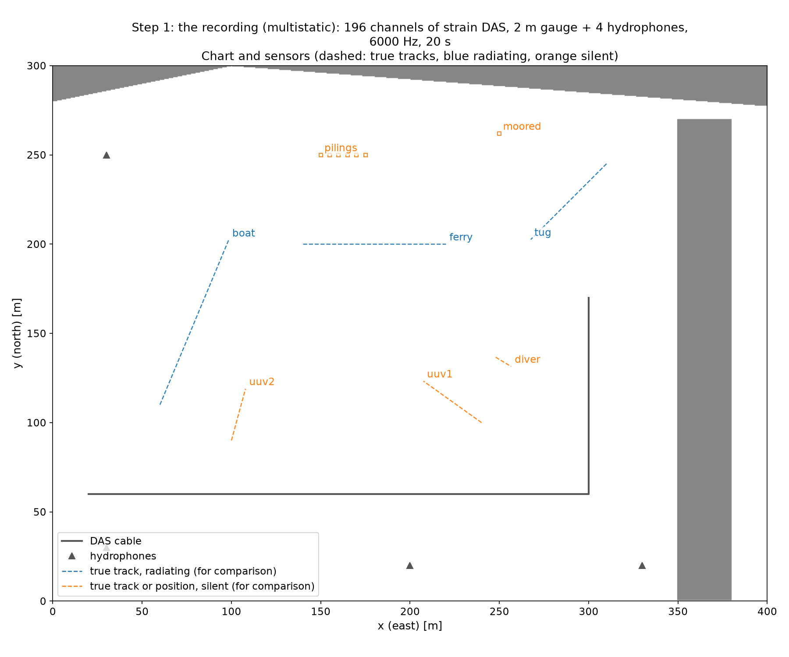
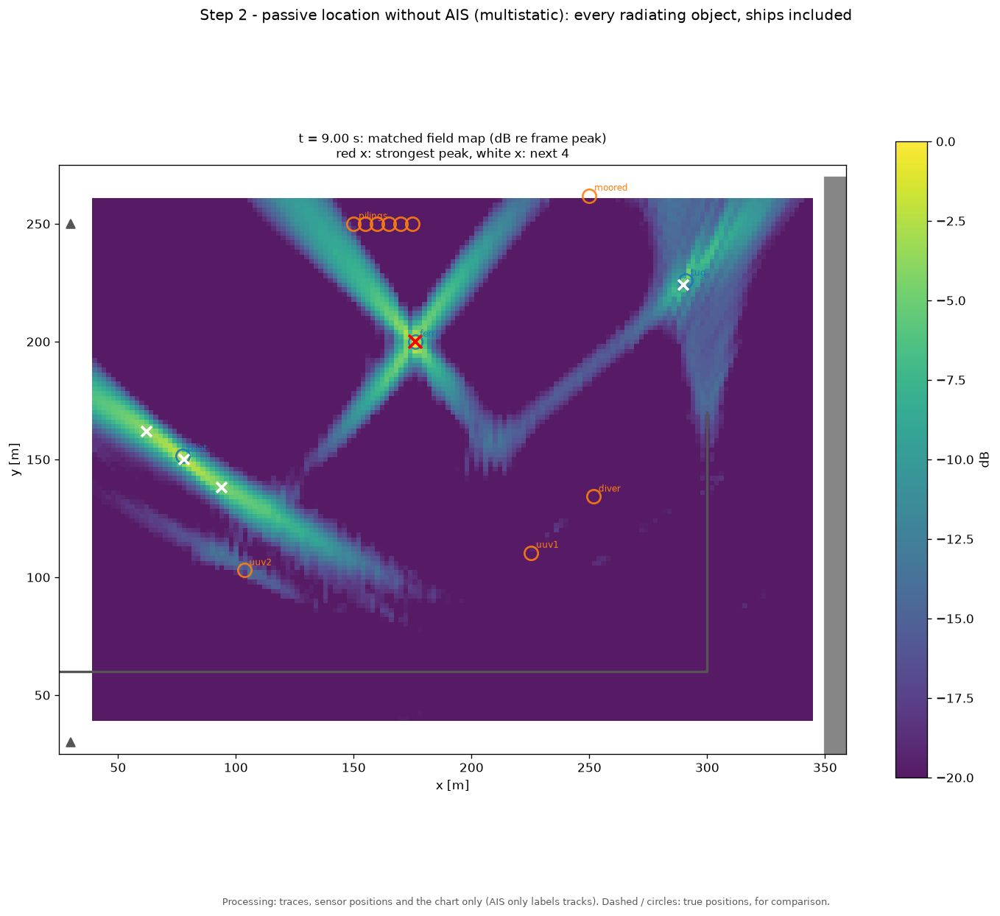
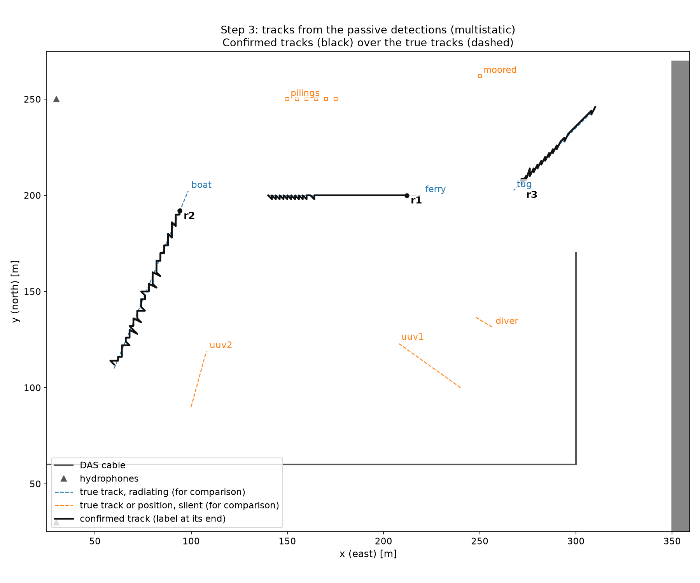
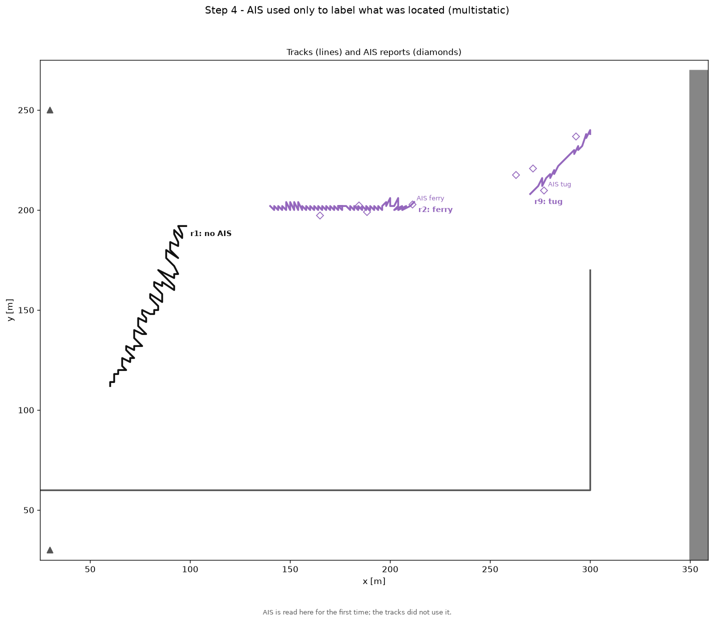
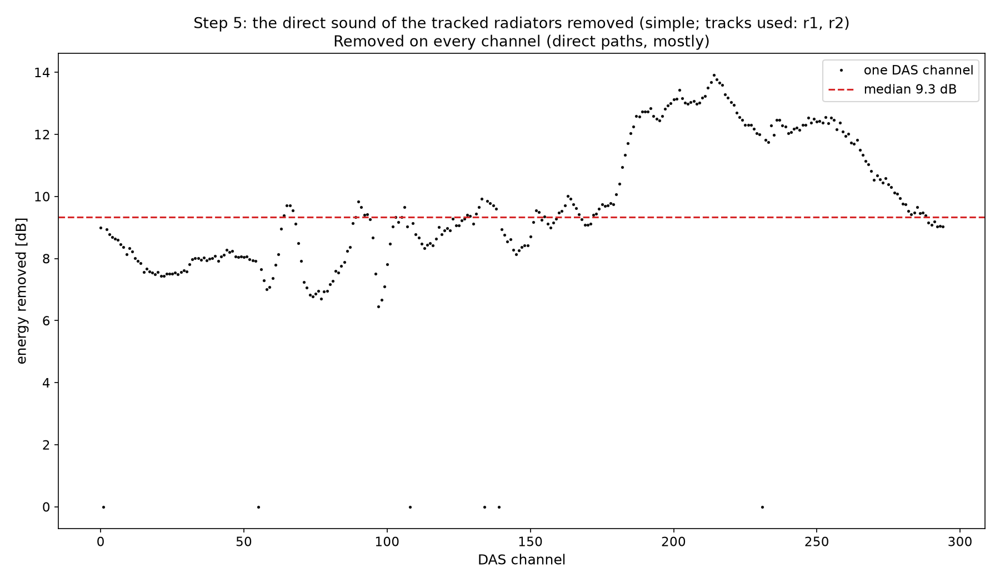
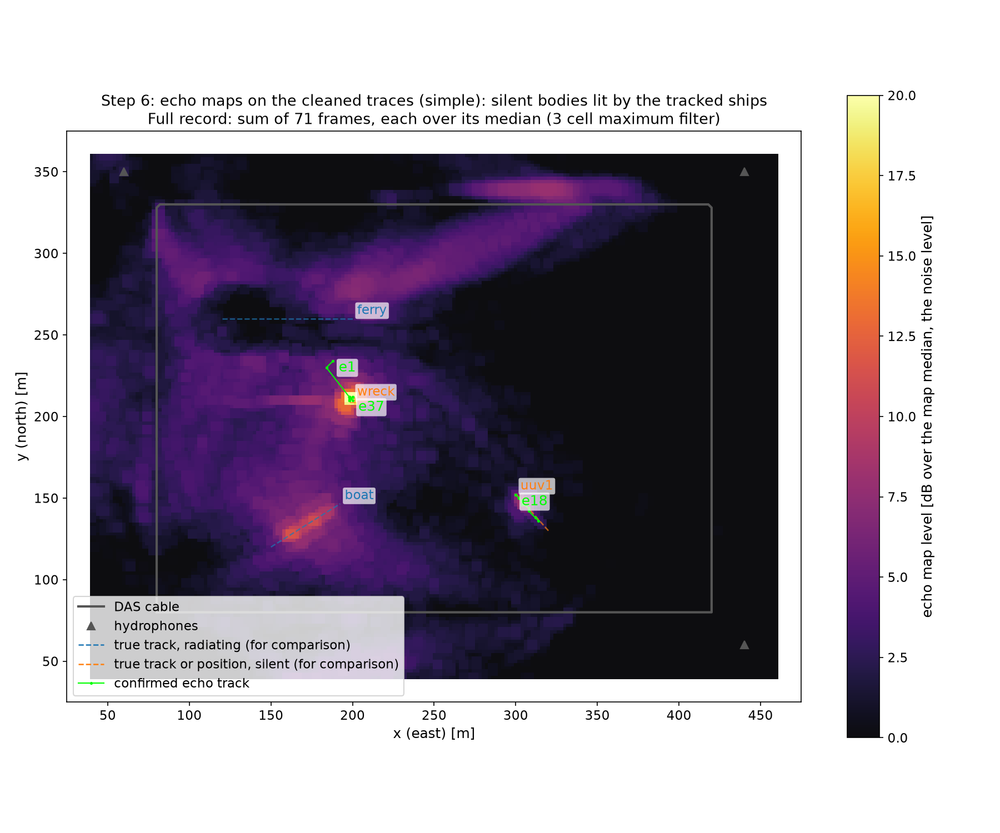
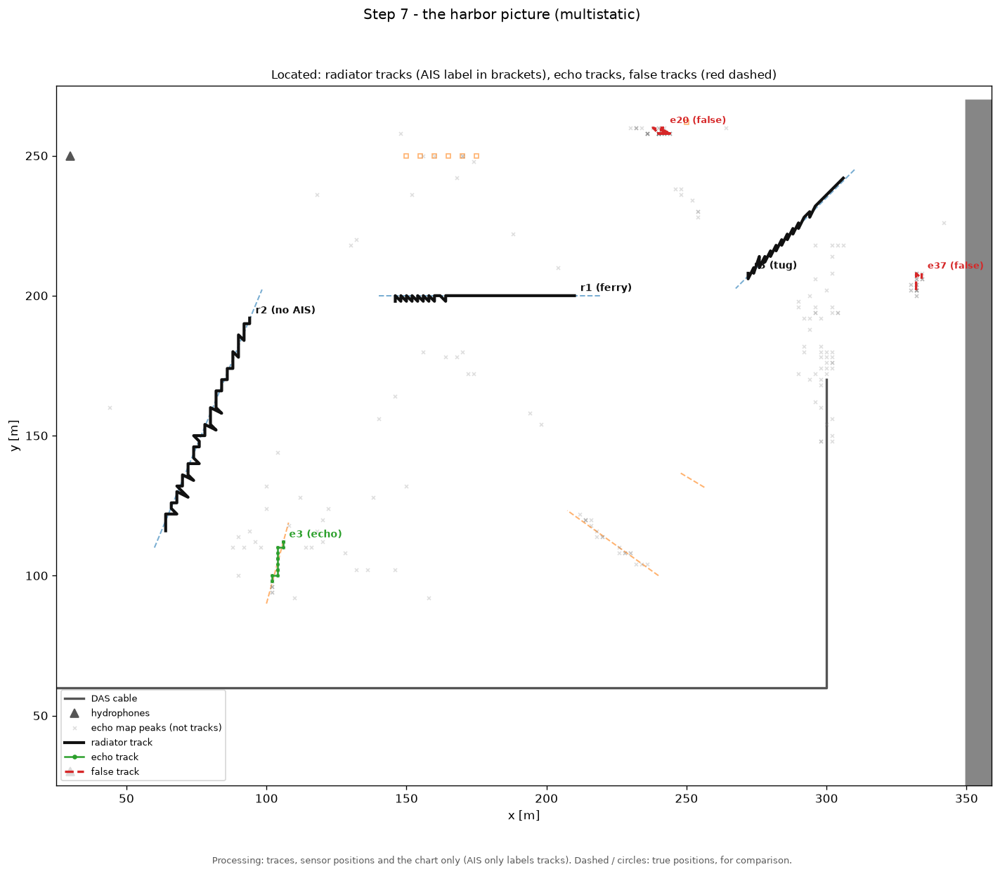
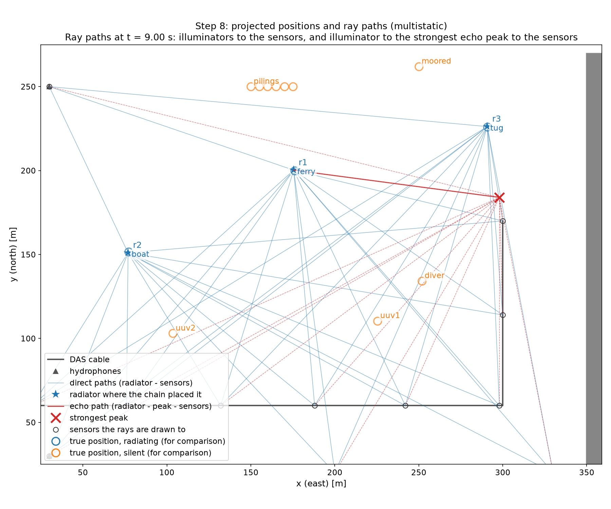
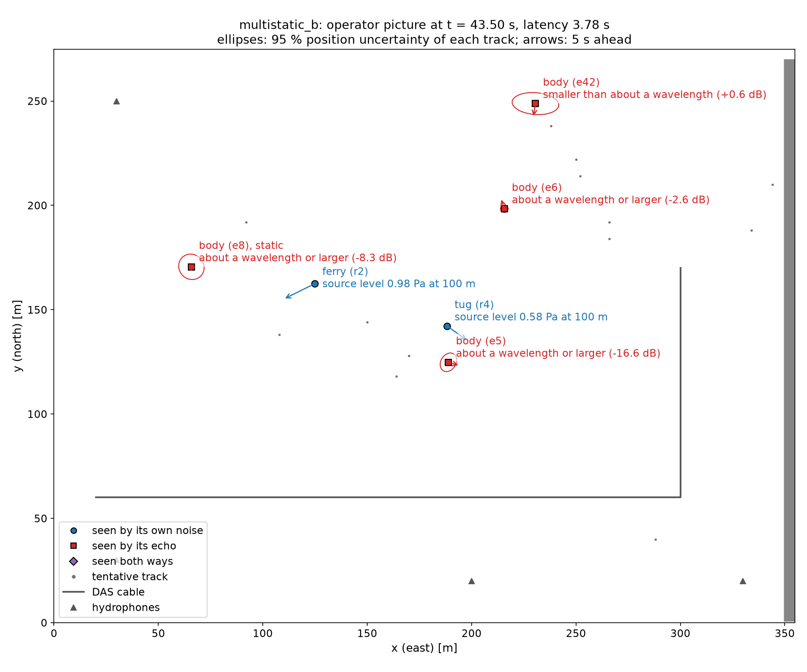

# Harbor: locating every object in a harbor from DAS and hydrophone traces

A plan view harbor in which a fibre optic cable (DAS) and hydrophones record ships and silent bodies. The system
locates every radiating object from the traces alone, tracks it, removes the ships' direct sound and tracks the silent
bodies by the ship noise they reflect, measures what each object is (where, how fast, how loud, how big against the
wavelength), and writes one picture of the harbor per quarter second. AIS reports only label what was found. The
recordings are synthetic (the package's FDTD forward model, `src/acoustic_sim/water/`); the processing cannot tell them
from a field recording ([Sensing contract](architecture.md#sensing-contract)).

**Status (stage 2): the ships are located and tracked from the traces alone, the ferry in every frame of every 0.5 m
recording, the boat in 65 to 100 %, the tug in 64 to 73 % of the frames of the multistatic seeds but only 18 % on the new
geometry `multistatic_b`; of the silent bodies the simple harbor's wreck and the bistatic UUV are tracked by their echo,
the silent bodies of the multi ship scene are not.  On the test recordings none of the four criteria fixed for this
stage is met** (the tug on `multistatic_b`, 2 to 12 false tracks per minute against 2, the wreck 83 to 100 % against
0.9, the size indicator not testable).  With the characteristics the chain no longer runs in real time on the 0.5 m
recordings (1.2 to 1.5 s of compute per second of data on a Quadro RTX 4000; for the compute before stage 2 see the
[history](harbor_history.md#findings-before-stage-2)).  Numbers, with tuning beside test recordings, in
[Numbers on recordings the parameters never saw](#numbers-on-recordings-the-parameters-never-saw).

Earlier work (the batch chains with AIS in the loop, stage 0 and stage 1, the performance work) is in
[Harbor, history](harbor_history.md).

## Running it

Three commands (in the dev container prefix each with `./dev.sh run`; the GPU is used when there is one, `--cpu`
otherwise):

```bash
# The system on one recording: picture.jsonl, summary.json, picture.mp4 (the operator view)
python -m acoustic_sim.water.stream --observation output/harbor_simple/fine/dataset.observation.npz \
    --processing examples/configs/processing/simple.json --out output/picture_simple

# The same, checked against where the objects really are (Pd, false tracks, characteristics against the truth)
python examples/harbor/05_detection/harbor_stream.py --dataset simple

# Every number of this page, on every tuning and test recording, compared with the committed numbers
python scripts/reproduce.py
```

`scripts/reproduce.py` builds any missing recording (the FDTD runs are cached), runs the system on all 17 recordings,
regenerates the walkthrough figures and writes `output/reproduce/latest.json` and `tables.md`; it compares every number
with the committed `output/reproduce/summary.json` (fractions of frames within 3 percentage points, median errors within
0.5 m, false tracks exactly; compute time and latency informational) and exits 1 if one differs. `--check` only compares,
`--update` makes the run the committed one. CI runs one tiny scenario end to end on the CPU
(`tests/harbor/test_ci_end_to_end.py`: 50 x 50 m, 2 s, a ferry and a wreck, about a minute); the full reproduce is run by
hand on the GPU.

## The system

One implementation of every step, `acoustic_sim.water.stream` (`HarborPicture`) over the objects of
`water/streaming.py`, fed the traces in 0.25 s chunks as they would arrive (a batch run, `harbor_detect.py`, is the same
stream with one chunk):

1. `StreamingPassive` locates the radiating objects, ships included, without AIS: channel QC, common mode, noise floors
   and the stationary interference projector over the last seconds, the matched field map of every frame, its 5
   strongest peaks.
2. `RadiatorTracker` turns the peaks into tracks (a peak joins the track it is predicted to be within 6 m of; a track is
   confirmed after 6 fixes in 2 s; one within 30 m of a stronger track is a sidelobe and is not confirmed).
3. `StreamingEcho` takes the confirmed tracks scoring at least a quarter of the strongest, removes the direct path of
   each from the traces (ECA with per sample delays, each with its own data reference beam, the track fitted over the
   past 4 s), and maps the echoes with every one of them as an illuminator.
4. A second `RadiatorTracker` tracks the echo peaks (gate 6 m, 8 fixes in 3 s, kept 8 s without a fix), the peaks within
   25 m of a confirmed radiator track left out so a residual direct path is not confirmed as a body. A confirmed track
   whose fitted speed stays below 0.2 m/s for 10 s is static.
5. `water/characteristics.py` measures every track (below); a radiator track and an echo track within 5 m of each other
   for 2 s are one object seen both ways.
6. The AIS reports received by each frame label the radiator tracks.

The 5 m harbor runs steps 1, 2, 5 and 6 (2 s frames, its own tracker settings). Every parameter of a recording is in
one file, `examples/configs/processing/<recording>.json` (band, scan edge, chunk, `ProcessingConfig`, `StreamConfig`,
both `TrackerConfig`s, `EchoStreamConfig`, `BistaticConfig`, the characteristics, and the scoring radii, which only the
scoring reads). `--set key=value` overrides one for an experiment (`--set echo.tracker.gate=8`) and is recorded. Every
output carries a `run` block (git commit and whether the tree was dirty, the config and observation files with their
sha256, versions, the GPU, the seed, the wall time, the provenance; [Architecture](architecture.md#provenance)).

## Numbers on recordings the parameters never saw

The constants of the processing configs were set while looking at the four recordings (noise seed 0 of `simple`,
`bistatic`, `multistatic`, `harbor`: the tuning set). They were frozen (commit tagged `stage2-freeze`) before the test
recordings existed: noise seeds 1 to 3 of each, mixed from the same cached FDTD gathers, and `multistatic_b`, the
multistatic harbor with every track changed (other headings, crossing points and speeds, the pilings and the hull moved,
the boat starting on the other side; same sensors and levels), run with the `multistatic` config unchanged. No
parameter was changed after the test numbers were seen. Scoring ([Architecture](architecture.md#scoreboard)): a track
is matched to the object nearest over its fixes if within 10 m (20 m on the 5 m harbor), otherwise it is a false track;
Pd is the fraction of frames, from the first frame the object could have been confirmed, with a confirmed track matched
to it within 5 m; the false alarm rate is false tracks per minute. Every track that was ever confirmed is scored (before
stage 2 only the tracks confirmed at the end of the record were, so these false track counts are higher than the
history's).

### Real time, tuning recordings beside test recordings

Pd: fraction of frames, from the first frame the object could have been confirmed, with a confirmed track matched to it within 5 m (radiator tracks for what radiates, echo tracks for silent bodies); test: the three noise seeds (each value) and multistatic_b. False tracks: confirmed tracks matched to no object, per minute.

| Recording | Split | Compute per s of data | Latency (median) | Pd per object | False tracks (per minute) |
|---|---|---|---|---|---|
| simple | tuning | 0.71 | 1.9 s | ferry 100 %; boat 100 %; uuv1 25 %; wreck 100 % | 3 (9.0) |
| simple | test | 0.71 / 0.71 / 0.70 | 1.9 s / 1.9 s / 1.9 s | ferry 100 % / 100 % / 100 %; boat 100 % / 100 % / 100 %; uuv1 25 % / 25 % / 25 %; wreck 100 % / 89 % / 83 % | 3 (9.0) / 2 (6.0) / 2 (6.0) |
| bistatic | tuning | 1.21 | 2.0 s | ferry 100 %; uuv1 59 % | 2 (6.0) |
| bistatic | test | 0.97 / 1.20 / 1.21 | 2.0 s / 2.0 s / 2.0 s | ferry 100 % / 100 % / 100 %; uuv1 55 % / 56 % / 55 % | 3 (9.0) / 3 (9.0) / 3 (9.0) |
| multistatic | tuning | 1.46 | 2.6 s | ferry 100 %; tug 64 %; boat 86 %; not tracked: uuv1, uuv2, diver, piling1, piling2, piling3, piling4, piling5, piling6, moored | 3 (9.0) |
| multistatic | test | 1.52 / 1.51 / 1.47 | 2.8 s / 2.5 s / 2.6 s | ferry 100 % / 100 % / 100 %; tug 65 % / 64 % / 73 %; boat 85 % / 65 % / 97 %; not tracked: uuv1, uuv2, diver, piling1, piling2, piling3, piling4, piling5, piling6, moored | 4 (12.0) / 3 (9.0) / 3 (9.0) |
| harbor | tuning | 0.53 | 1.1 s | ferry 56 %; tug 0 %; moored 0 %; uuv1 0 %; uuv2 0 %; diver 0 % | 6 (3.0) |
| harbor | test | 0.52 / 0.52 / 0.52 | 1.1 s / 1.1 s / 1.1 s | ferry 56 % / 54 % / 52 %; tug 0 % / 0 % / 0 %; moored 0 % / 0 % / 0 %; uuv1 0 % / 0 % / 0 %; uuv2 0 % / 0 % / 0 %; diver 0 % / 0 % / 0 % | 5 (2.5) / 7 (3.5) / 4 (2.0) |
| multistatic_b | test | 1.35 | 2.8 s | ferry 100 %; tug 18 %; boat 100 %; not tracked: uuv1, uuv2, diver, piling1, piling2, piling3, piling4, piling5, piling6, moored | 4 (12.0) |

All numbers above are regenerated by `scripts/reproduce.py` (`output/reproduce/summary.json`; per recording
`output/reproduce/runs/<recording>/`). What they say:

* **Tuning to test.** The noise seeds change little: the ships' Pd stays within a few points (the multistatic boat 65 to
  97 % across seeds, the widest spread), the bistatic UUV 59 % to 55 %, the simple harbor's UUV 25 % on every seed, the
  wreck 100 % to 89 % and 83 % on two seeds. The new geometry is where the chain drops: on `multistatic_b` the tug is
  tracked in 18 % of the frames. Its map peaks are within 5 m in 42 % of the frames, but no track of them confirms
  until 15 s (6 fixes in 2 s within a 6 m gate are not met while the tug's peaks come and go behind the louder ferry and
  boat); the ferry and the boat are tracked in 100 %.
* **False tracks.** Every track ever confirmed is scored, so a 20 s recording with a single false track already has 3 per
  minute. The false radiator tracks are the passive chain locating something that is not a radiator: on the simple
  harbor three short tracks 13 to 32 m from the wreck, where it locates the ferry's echo off the wreck (shown for r19
  before stage 2); on the bistatic recording sidelobes of the ferry 41 m from it; on `multistatic_b` sidelobes of the boat
  41 to 45 m from it. The radiator tracker's sidelobe exclusion (30 m) is shorter than these distances. Of the
  multistatic recording's two false echo tracks, e32 (median position (234, 260) m) lies on the west end of the 30 m
  moored hull (x 235 to 265 m): an echo of the hull, counted false because it is 16 m from the hull's centre, which is
  what the scoring measures to; e26 is 60 m from the tug, a residual of its direct path.
* **Silent bodies of the multi ship scene.** No echo track of the two UUVs, the diver, the pilings or the moored hull is
  confirmed on any multistatic recording: their echo peaks do not repeat for 8 frames in 3 s. The direct path removal of
  the other ships is still too shallow ([history](harbor_history.md#findings-before-stage-2)); that is stage 3's problem.
* **The 5 m harbor** tracks the ferry in 52 to 56 % of its frames and nothing else; of its test recordings only seed 3
  has at most 2 false tracks per minute (2.0; the others 2.5 and 3.5).

### Criteria

Fixed before the test recordings were built (`scripts/reproduce.py`, `CRITERIA`), scored on the test recordings:

| Criterion | Values | Result |
|---|---|---|
| every ship (ferry, tug, boat) tracked with Pd >= 0.8 on multistatic_b (radiator tracks) | {'ferry': 1.0, 'tug': 0.18, 'boat': 1.0} | **fail** |
| false tracks at most 2 per minute on every test recording | {'simple_seed1': 9.0, 'simple_seed2': 6.0, 'simple_seed3': 6.0, 'bistatic_seed1': 9.0, 'bistatic_seed2': 9.0, 'bistatic_seed3': 9.0, 'multistatic_seed1': 12.0, 'multistatic_seed2': 9.0, 'multistatic_seed3': 9.0, 'harbor_seed1': 2.5, 'harbor_seed2': 3.5, 'harbor_seed3': 2.0, 'multistatic_b': 12.0} | **fail** |
| the wreck of the simple harbor found by its echo with Pd >= 0.9 on seeds 1 to 3 (echo tracks) | {'simple_seed1': 1.0, 'simple_seed2': 0.89, 'simple_seed3': 0.83} | **fail** |
| on frames where the moored hull, a UUV and a piling are all measured, the size indicator puts the hull below the piling in at least 70 % of them (multistatic recordings, tuning and multistatic_b) | no frame had the hull, a UUV and a piling all measured: not testable | **not met: not testable** |

The size criterion could not be evaluated: no echo track of the hull, a UUV or a piling was confirmed on either
multistatic recording, so there was no frame with all three measured.

## Walkthrough: from the traces to the harbor picture

`examples/harbor/06_walkthrough/` takes one recording through the system, one image per plot
(`./examples/harbor/06_walkthrough/run_all.sh DATASET`, DATASET one of `simple`, `bistatic`, `multistatic`, `harbor`; each
script also runs on its own). The chain runs once (`water/stream.py`, cached in `output/walkthrough/<dataset>/cache/`;
`scripts/reproduce.py` deletes the cache and runs it again) and the images go to `output/walkthrough/<dataset>/`. Nothing in
the processing reads the truth or the AIS reports: the truth is drawn (dashed lines, circles) only to show where the
objects really are, and AIS enters in step 4 only. Below: the multistatic recording (three ships, two UUVs, a diver, six
pilings and a moored hull) and, for the echo steps, the [simple harbor](#the-simple-harbor). All four recordings have the
full set (the 5 m harbor without steps 5 and 6).

**1. The recording** (`01_recording.py`). What the system gets: the chart, the sensor positions (a DAS cable and four
hydrophones) and the traces (`01_recording_gather.png`, `_spectrogram.png`, `_trace.png`). The cable of the bistatic and
multistatic recordings is in strain mode (the second difference of the field over the gauge length); the simple harbor
and the 5 m harbor have a pressure mode cable.



**2. Passive location** (`02_passive_map.py`). Every 0.25 s the matched field processor steers the array at every cell of
the scan grid; a radiating object lights up. The 5 strongest peaks of each frame are the passive detections; ships are
located like everything else, without their AIS reports (three frames, `02_passive_map_1.png` to `_3.png`).



**3. Tracks** (`03_tracks.py`). Peaks that follow on in space and time become tracks; a track is confirmed after 6 fixes in
2 s, and one that sits within 30 m of a stronger track (a sidelobe) is not. Every peak is in `03_tracks_peaks.png`, the
tracks against the nearest true object in `03_tracks_table.png`.



**4. AIS afterwards** (`04_ais_crosscheck.py`). Only now are the AIS reports read: a track within 25 m of a reporting ship
takes its name; a track that matches no report is a radiating object without AIS (here the boat). The distance of every
track to every reporting ship over time is `04_ais_crosscheck_distance.png`.



**5. Removing the ships' own sound** (`05_direct_path_removal.py`). A silent body is seen only by the ship noise it
reflects, far below the ship's direct sound. For every strong track the chain forms a reference beam toward it
and removes the delayed copies of that reference from every channel (ECA, delays following the track). On one channel
(`_trace.png`, `_spectrum.png`) and over every channel:



**6. The echo map and the echo tracks** (`06_echo_map.py`). On the cleaned traces every cell is tested as a reflector of
each tracked ship's sound. The peaks of every frame feed the echo tracker, which keeps a body only when its echo comes
back for 8 frames in 3 s; the picture shows the echo tracks, the raw peaks faint underneath. Three frames
(`06_echo_map_1.png` to `_3.png`) and the record summed (each frame over its median, so the scale is dB over the noise
level), with every confirmed echo track: the wreck is tracked through the record, the UUV for part of it.



**7. The harbor picture** (`07_harbor_picture.py`). Radiator tracks (with their AIS label) and echo tracks over the true
positions, scored with the stage 2 definitions (table: `07_harbor_picture_table.png`, `07_harbor_picture.json`). On the
multistatic recording the three ships are tracked (the ferry in every frame, the tug and the boat in 64 % and 86 %); no
silent body is; one false radiator track and two false echo tracks, one of them on the moored hull's west end.



**8. The geometry** (`08_geometry.py`). Where the chain projects each track ahead (the straight line fit the tracker gates
with and the echo chain places the illuminator by) against where the object really was (`08_geometry_projection.png`),
how far ahead that holds (`08_geometry_lookahead.png`), and one frame's map with its ray paths: the illuminator where the
echo chain placed it, its direct paths to a few sensors, the echo path through the strongest peak and the ellipse of
equal delay through it (an echo can come from anywhere on that ellipse; the array's aperture picks the point).



The same frame geometry is in `check_<chain>_frame.png` of every run of `harbor_stream.py` and `scripts/reproduce.py`.

## What the objects are: measured characteristics

No classifier: measured quantities a harbor operator can read, attached to every track with the frames they were
measured over (`water/characteristics.py`; it reads the stream's spectra, maps and tracks, never the truth).

| For | Quantity | How it is measured |
|---|---|---|
| every track | position and its uncertainty | the fitted position; the full widths at half maximum of the map peak that fed the latest fix along its two principal axes and the major axis direction; the rms residual of the fixes about the straight line fitted over the last 4 s |
| | velocity, heading | from that fit, with the standard errors of the fit |
| | how it is seen | own noise, echo, or both (a radiator and an echo track within 5 m for 2 s) |
| | AIS | the reporting ship whose dead reckoned reports lie within 25 m of the track (median over its last 8 fixes), and the distance between reported and located position at the latest fix; else "no report" |
| | status | tentative, confirmed, static (fitted speed below 0.2 m/s for 10 s), lost (no fix for the drop time; kept 4 s, faded); frames detected over frames since confirmation |
| radiator | received level | the least squares source spectrum toward the track from every live channel with the chain's own replicas (so strain and pressure channels share one unit), propagated to the median range from the track to the channels, rms in the band, in trace units |
| | source level at 100 m | the received level with cylindrical spreading from that range, times one constant calibrated on the simple harbor (ferry 1.0 Pa, boat 0.3 Pa at 100 m: 5.1152; `harbor_level_calibration.py`, `output/harbor_level_calibration/calibration.json`) |
| | tonal lines | the 3 strongest local maxima of that spectrum at least 6 dB over its running median (21 bins): frequency, level over the floor, frames in which a line within one bin was found |
| echo | echo strength, per illuminator | the least squares source spectrum at the echo's cell over the illuminator's direct field there (its data reference divided by the beam's gain, propagated to the cell), coherent over the band, dB |
| | size indicator | that ratio in the upper third of the band over the lower third, dB: above 0 dB "smaller than about a wavelength", else "about a wavelength or larger" (never metres) |
| | extent | the length of the half maximum region of the echo peak along and across the direction from the strongest illuminator |

Reported values are medians over the last 8 frames the track was measured in. A body small against the wavelength
scatters more at high frequency, a body large against it about equally; in the 100 to 760 Hz band the wavelengths are 2
to 15 m, so the indicator can separate a 1 m piling or a diver from the 30 m moored hull and says little about a 1 x 3 m
UUV. **The forward model's bodies are two dimensional pressure release masks**, so the comparison with the true sizes
is a check of the measurement, not of the physics of real hulls.

### Validation against the truth

| Recording | Object | True type, size | Seen | Detected frames | Size ratio [dB] | Size indicator | Echo extent along / across [m] | Source level [Pa] (true) | Half max width [m] | Speed [m/s] (true) |
|---|---|---|---|---|---|---|---|---|---|---|
| multistatic | ferry | ship, - | own noise 66 | 66 | - | - | - | 1.15 (1) | 13.9 x 3.8 | 4.0 (4.0) |
| multistatic | tug | ship, - | own noise 67 | 42 | - | - | - | 0.79 (0.7) | 25.1 x 7.5 | 2.8 (3.0) |
| multistatic | boat | ship, - | own noise 66 | 57 | - | - | - | 0.54 (0.3) | 47.1 x 6.9 | 4.9 (5.0) |
| multistatic_b | ferry | ship, - | own noise 66 | 66 | - | - | - | 1.15 (1) | 14.2 x 6.1 | 3.6 (3.5) |
| multistatic_b | tug | ship, - | own noise 12 | 12 | - | - | - | 0.68 (0.7) | 40.4 x 5.4 | 2.9 (2.5) |
| multistatic_b | boat | ship, - | own noise 66 | 66 | - | - | - | 0.45 (0.3) | 28.5 x 5.4 | 4.6 (4.5) |
| simple | ferry | ship, - | own noise 66 | 66 | - | - | - | 1.10 (1) | 4.6 x 3.5 | 4.0 (4.0) |
| simple | boat | ship, - | own noise 66 | 66 | - | - | - | 0.27 (0.3) | 4.6 x 2.3 | 2.5 (2.5) |
| simple | uuv1 | uuv, 6 x 2 m | echo 16 | 16 | -4.9 | about a wavelength or larger | 3.5 / 3.3 | - | 4.6 x 2.3 | 1.0 (1.5) |
| simple | wreck | static, 4 x 4 m | echo 64 | 64 | -4.7 | about a wavelength or larger | 4.8 / 4.8 | - | 4.6 x 4.6 | 0.2 (0.0) |
| simple_seed1 | ferry | ship, - | own noise 66 | 66 | - | - | - | 1.08 (1) | 4.6 x 3.5 | 4.0 (4.0) |
| simple_seed1 | boat | ship, - | own noise 66 | 66 | - | - | - | 0.26 (0.3) | 4.6 x 2.3 | 2.5 (2.5) |
| simple_seed1 | uuv1 | uuv, 6 x 2 m | echo 16 | 16 | -0.3 | about a wavelength or larger | 4.8 / 3.5 | - | 5.2 x 3.5 | 1.1 (1.5) |
| simple_seed1 | wreck | static, 4 x 4 m | echo 64, own noise 28 | 64 | -4.4 | about a wavelength or larger | 4.8 / 4.8 | 0.15 (0) | 4.6 x 4.6 | 0.2 (0.0) |
| bistatic | ferry | ship, - | own noise 66 | 66 | - | - | - | 1.22 (1) | 11.6 x 4.1 | 4.0 (4.0) |
| bistatic | uuv1 | uuv, 3 x 1 m | own noise 55, echo 38 | 47 | +0.6 | smaller than about a wavelength | 5.8 / 3.7 | 0.18 (0) | 44.4 x 5.5 | 3.5 (2.0) |
| bistatic_seed1 | ferry | ship, - | own noise 66 | 66 | - | - | - | 1.25 (1) | 10.4 x 4.4 | 4.0 (4.0) |
| bistatic_seed1 | uuv1 | uuv, 3 x 1 m | own noise 40, echo 36 | 58 | +1.1 | smaller than about a wavelength | 5.9 / 4.6 | 0.18 (0) | 36.0 x 4.2 | 2.2 (2.0) |

What the characteristics get right and wrong:

* **Speed and heading** of the tracked ships are within 0.5 m/s of the truth on every recording (the multistatic boat
  4.9 m/s against 5.0, the `multistatic_b` ferry 3.6 against 3.5); the echo tracked UUVs are slower or faster by 0.5 to
  1.5 m/s (few fixes, 2 m map cells).
* **Source level**: within 2 dB of the truth for every ship of the simple, bistatic and multistatic recordings except
  the boat of the multistatic scenes (+3.5 to +5.3 dB: its map peak shares energy with the louder ships' sidelobes); the
  constant from the simple harbor does not carry to the 5 m harbor (+13.5 to +13.8 dB: another grid, band and signature
  spectrum). Table below.
* **Size indicator**: the simple harbor's 4 m wreck is "about a wavelength or larger" (-4.4 to -4.7 dB; wavelengths 4 to
  15 m there) and the bistatic 1 x 3 m UUV "smaller than about a wavelength" (+0.6 to +1.1 dB; wavelengths 2 to 15 m);
  the simple harbor's 6 x 2 m UUV flips between seeds (-4.9 and -0.3 dB, 16 frames). The criterion of the stage (hull
  below piling) is untestable because neither is tracked.
* **How it is seen**: the bistatic UUV is reported "seen both ways": the passive chain locates the ferry's echo off it
  and the radiator tracker tracks that, so a silent body is labelled as radiating. The same mechanism makes the simple
  harbor's wreck "seen both ways" on seed 1.
* **Half maximum widths** are a few metres on the simple harbor's loop (4.6 x 2.3 to 4.6 x 3.5 m) and long and thin
  on the strain cable of the 0.5 m recordings (14 to 47 m along, 4 to 8 m across): the cable sees the ships from one
  side, and the map peak is elongated toward it. They are the map's resolution, not the location error (the fixes of
  the same tracks are within 1 to 3 m of the truth).
* **Tonal lines** are reported with their persistence (`picture.jsonl`); a ship's lines persist only in a minority of
  the frames its track was measured in (2 Hz bins of the 0.5 s frames), so they are numbers for an operator, not yet a
  signature.

### Source level estimates against the truth (radiator tracks; calibration constant 5.1152 from the simple harbor's tuning recording)

| Recording | Object | True [Pa] | Estimate [Pa] | Error [dB] |
|---|---|---|---|---|
| simple | ferry | 1 | 1.100 | +0.8 |
| simple | boat | 0.3 | 0.270 | -0.9 |
| bistatic | ferry | 1 | 1.217 | +1.7 |
| multistatic | ferry | 1 | 1.151 | +1.2 |
| multistatic | tug | 0.7 | 0.787 | +1.0 |
| multistatic | boat | 0.3 | 0.536 | +5.0 |
| harbor | ferry | 1 | 4.837 | +13.7 |
| simple_seed1 | ferry | 1 | 1.079 | +0.7 |
| simple_seed1 | boat | 0.3 | 0.264 | -1.1 |
| simple_seed2 | ferry | 1 | 1.077 | +0.6 |
| simple_seed2 | boat | 0.3 | 0.266 | -1.0 |
| simple_seed3 | ferry | 1 | 1.065 | +0.5 |
| simple_seed3 | boat | 0.3 | 0.261 | -1.2 |
| bistatic_seed1 | ferry | 1 | 1.247 | +1.9 |
| bistatic_seed2 | ferry | 1 | 1.237 | +1.9 |
| bistatic_seed3 | ferry | 1 | 1.228 | +1.8 |
| multistatic_seed1 | ferry | 1 | 1.176 | +1.4 |
| multistatic_seed1 | tug | 0.7 | 0.799 | +1.2 |
| multistatic_seed1 | boat | 0.3 | 0.543 | +5.2 |
| multistatic_seed2 | ferry | 1 | 1.179 | +1.4 |
| multistatic_seed2 | tug | 0.7 | 0.790 | +1.0 |
| multistatic_seed2 | boat | 0.3 | 0.551 | +5.3 |
| multistatic_seed3 | ferry | 1 | 1.165 | +1.3 |
| multistatic_seed3 | tug | 0.7 | 0.794 | +1.1 |
| multistatic_seed3 | boat | 0.3 | 0.546 | +5.2 |
| harbor_seed1 | ferry | 1 | 4.791 | +13.6 |
| harbor_seed2 | ferry | 1 | 4.876 | +13.8 |
| harbor_seed3 | ferry | 1 | 4.755 | +13.5 |
| multistatic_b | ferry | 1 | 1.150 | +1.2 |
| multistatic_b | tug | 0.7 | 0.680 | -0.2 |
| multistatic_b | boat | 0.3 | 0.449 | +3.5 |

## The operator output

### `picture.jsonl`

One JSON record per frame, written as the stream runs (`--out <dir>/picture.jsonl`); the first line is the header. It is
the interface a display or a logger would consume.

```
{"header": {"schema": "harbor_picture/1", "recording": ..., "run": {...run block...}, "fields": ...}}
{"t": 12.5,                       # frame centre [s] in the time base of the recording
 "latency_s": 1.9,                # last sample of the frame recorded -> record written
 "chains": {"passive": true, "echo": true},     # which chains produced this frame
 "objects": [
   {"id": "r1+e3",                # the track ids, joined when one object is seen both ways
    "seen": "own noise" | "echo" | "both",
    "tracks": {"radiator": "r1", "echo": "e3"},
    "track_state": {"r1": {"status", "xy", "fix_t", "fix_xy", "detected"}, ...},   # each track's own state
    "status": "tentative" | "confirmed" | "static" | "lost",
    "detected_frames": 37, "frames_since_confirmation": 51,
    "position": {"xy": [x, y],    # fitted position at t [m]
                 "fix_t", "fix_xy", "detected",          # latest fix, and whether this frame gave one
                 "halfmax_width_m": [major, minor], "halfmax_major_deg", "width_measured_t",
                 "residual_m", "window_s": [t0, t1], "n_fixes"},
    "velocity": {"vxy", "speed", "speed_se", "heading_deg", "heading_se_deg", "window_s", "n_fixes"},
    "ais": {"id": "ferry", "distance_m": 9.6, "fix_t": 14.0} | {"id": null, "note": "no report"},
    "lost_t": ...,                # lost tracks only
    "radiator": {"received_level", "range_m", "source_level_100m_pa", "calibration",
                 "tonal_lines": [{"f_hz", "level_db", "frames"}], "lines_frames_measured", "window_s", "n_frames"},
    "echo": {"strength_db": {"r1": -8.2, ...}, "size_ratio_db", "size", "extent_m": {"along", "across"},
             "illuminator", "window_s", "n_frames", "xy"}}]}
```

Angles are degrees clockwise from north; positions in the chart's local east / north frame [m]; a tentative object
carries only its position. `acoustic_sim.water.stream.read_picture` reads a file back.

### The operator view

`HarborPictureView` (`water/plotting.py`) draws one figure per record: the chart and the sensors, every object as a
marker (circle: own noise, square: echo, diamond: both) with its half maximum ellipse, a velocity vector 5 s ahead and
its label (AIS identity, else "radiator" or "body"; the size indicator; the source level), tentative tracks as dots,
lost tracks faded. It is saved as `picture.mp4` per recording and shown live with `--show`. The truth is drawn only with
`--truth` (dashed) and is off by default.



One frame of `multistatic_b` (a test recording) at 13.5 s: the ferry with its AIS identity, the boat (no AIS), a false
track (r12, a sidelobe of the boat 41 m from it), and the tug only as a trail of tentative fixes on the left: it is not
confirmed until 15 s. Every recording's frame is in `output/reproduce/runs/<recording>/picture_frame.png`; the videos
(`picture.mp4`) are not committed.

### On a field recording

`python -m acoustic_sim.water.stream --observation <file> --processing <config> --out <dir>` needs nothing but the
observation file: convert a recording with `Observation.from_arrays` ([Architecture, real data entry
point](architecture.md#real-data-entry-point)), save it, and start from the processing config of the recording closest
to it (band, grid, chunk).

## Recordings

| Recording | Grid, band | Sensors | Objects |
|---|---|---|---|
| `simple` | 500 x 400 m basin, 1 m, 3 kHz, 20 s; 100-380 Hz | a pressure DAS loop (299 channels) and 4 hydrophones | AIS ferry (1.0 Pa), boat without AIS (0.3 Pa), silent 6 x 2 m UUV, static 4 m wreck |
| `bistatic` | 400 x 300 m crop, 0.5 m, 6 kHz, 20 s; 100-760 Hz | a strain DAS cable (2 m gauge) and 4 hydrophones | AIS ferry, silent 1 x 3 m UUV |
| `multistatic` | as `bistatic` | as `bistatic` | AIS ferry (1.0 Pa) and tug (0.7 Pa), boat without AIS (0.3 Pa), two silent UUVs, a diver, six 1 m pilings 5 m apart, a moored 30 x 6 m hull |
| `multistatic_b` (test only) | as `multistatic` | as `multistatic` | the same objects, every track, the pilings and the hull moved |
| `harbor` | 2400 x 1800 m, 5 m, 600 Hz, 120 s; 12-78 Hz | a pressure DAS cable and 4 hydrophones | AIS ferry and tug, moored ship, radiating UUVs and diver, a silent scatterer |

The 0.5 m recordings each take six FDTD runs (every illuminator with all bodies and with none); every recording's
gathers are cached, so noise seeds and level changes need no FDTD run. Building: `harbor_multistatic_dataset.py`
(`--config` for `simple` and `multistatic_b`), `harbor_bistatic_dataset.py`, `harbor_m2_dataset.py`;
`scripts/reproduce.py` builds whatever is missing. The default 5 m scenario and the bistatic scenario are described in
[the history](harbor_history.md#the-default-scenarios).

### The simple harbor

`examples/configs/harbor_simple.scenario.json` (`environment.kind = "simple"`) is built so that its wavefields are easy to
resolve: one straight 20 m quay along the north edge (a single reflector), open water elsewhere absorbed by the 40 m
sponge, 1500 m/s everywhere (the chart's single sound speed is the true one), a pressure mode DAS loop around the scene
(80 to 420 m by 80 to 330 m, 4 m channels: every angle covered, no strain directivity) and four corner hydrophones, the
objects inside the loop and 50 m or more apart. The levels of direct sound, echo and noise on the cable are in
`output/harbor_simple/fine/levels.json`.

### The forward model's own propagation error

The simulated water propagates the direct paths faster than the chart's sound speed, by an amount that depends on
direction: the FDTD scheme's dispersion at 2 to 4 cells per wavelength at the top of the band
([history](harbor_history.md#findings-before-stage-2)). `harbor_propagation_error.py` measures it on each recording
from the truth side: one FDTD run of a stationary Ricker pulse at the first ship's mid record position, the arrival at
each hydrophone (the peak of the envelope of the band limited cross correlation with the free field prediction at the
chart's speed) minus range over that speed. It is written into the truth file's `meta` as `propagation_error_ms` and
drawn in `output/<recording>/propagation_error.png`. The forward model is not changed in this stage.

| Recording | Band [Hz] | Chart speed [m/s] | Per hydrophone: error [ms] (direction, range) |
|---|---|---|---|
| simple | 100-380 | 1500.0 | -2.71 (207 deg, 224 m); -5.23 (126 deg, 344 m); -2.44 (312 deg, 135 m); -2.29 (72 deg, 294 m) |
| bistatic | 100-760 | 1493.7 | -3.17 (221 deg, 227 m); -3.07 (140 deg, 234 m); -1.21 (288 deg, 158 m); -1.10 (174 deg, 181 m) |
| multistatic | 100-760 | 1493.7 | -3.17 (221 deg, 227 m); -3.07 (140 deg, 234 m); -1.21 (288 deg, 158 m); -1.10 (174 deg, 181 m) |
| harbor | 12-78 | 1496.0 | -12.71 (297 deg, 1047 m); -3.33 (302 deg, 153 m); -11.56 (44 deg, 672 m); -4.17 (153 deg, 268 m) |
| multistatic_b | 100-760 | 1493.7 | -3.55 (227 deg, 271 m); -2.32 (152 deg, 219 m); -1.15 (280 deg, 202 m); -1.21 (188 deg, 196 m) |

On the 0.5 m and 1 m recordings the pulse arrives 1.1 to 5.2 ms early over 135 to 344 m, the most in the directions
closest to the grid's diagonals and at the longest ranges; on the simple harbor, whose water has exactly the chart's
speed, the whole error is the scheme's (2.3 to 5.2 ms). The bistatic and multistatic recordings share the crop, the
sensors and the ferry's track, so their pulse and their numbers are the same. On the 5 m harbor the shallow water near
the shore is slower than the chart's median speed and the error grows with range (3.3 ms at 153 m, 12.7 ms at 1047 m).

## Physical and interpretation limits

This is a **2-D plan-view scalar pressure model**, not a 3-D shallow-water solver. The depth map
is informational; distance from shore is used to derive a small effective sound-speed drop.
Land cells are pressure-release boundaries. Shore loss is a numerical damping ramp that limits
ringing, not a measured seabed absorption law. The pressure-only solver has no rigid Neumann hull
boundary; `Scatterer` bodies use smooth pressure masks (soft/pressure-release or absorbing
approximations). Body geometry should span multiple grid cells for meaningful shape resolution.

The dataset builder caches each radiating vessel's unit-level FDTD gather and then mixes levels
and noise linearly. Scattering is represented by a run with a body minus the matching run
without it; by default each body is run on its own, so multiple scattering between distinct
bodies is not included. `render_vessel_gathers(combined_bodies=True)` (the multistatic dataset)
instead runs every radiating vessel once with all the bodies present and once with none, which
keeps the multiple scattering but loses the per body split.

## Modules (`src/acoustic_sim/water/`)

| Module | Role |
|--------|------|
| `stream.py` | The system: `HarborPicture`, `run`, `load_processing`, the `picture.jsonl` records, the command line |
| `streaming.py` | `StreamingPassive`, `RadiatorTracker` (radiator and echo tracks), `StreamingEcho`, `ais_crosscheck` |
| `characteristics.py` | The measured characteristics of every track |
| `detection.py` | Spectra, channel QC, common mode, noise floor, the matched field scanner and its interference projector |
| `bistatic.py` | The data reference beam, the ECA, `BistaticConfig` (the batch chain `run_bistatic` is history) |
| `propagation.py` | `FreeFieldPropagator` and `green2d`: the replicas from the chart alone |
| `sensors.py`, `ais.py` | `SensorLayout` (pressure and strain DAS, hydrophones, `collapse`); AIS reports and the predictor |
| `scoreboard.py`, `evaluate.py` | Scoring against the `Truth` (`score_picture`, `match_tracks`, `peak_hits`; the stage 1 threshold method as a diagnostic) |
| `plotting.py` | The chart and geometry overlays, `HarborPictureView` |
| `scenario.py`, `environment.py`, `vessels.py`, `signatures.py`, `noise.py`, `ais_sim.py`, `fdtd_runner.py`, `fdtd_cuda_bodies.py`, `scatterer.py`, `dispersion.py`, `dataset.py`, `sensor_sampling.py` | The forward model: scenario, land and sound speed, tracks and signatures, noise, synthetic AIS, the FDTD runner and its bodies, the mixer and the observation / truth files |
| `diagnostics.py` | Forward model knowledge on the inference path, flagged in the provenance (`SimulatorAwarePropagator`, ...) |
| `device.py` | CPU / GPU selection |
| `suppression.py`, `occupancy.py`, `localiser.py`, `classifier.py`, `motion.py` | History ([Architecture](architecture.md#history-water-processing)) |

`acoustic_sim.harbor` is a compatibility alias of `acoustic_sim.water`.

## Tests

Run the test files of what changed (`./dev.sh run python -m pytest tests/harbor/<file>`); the GPU variants skip
without CuPy or a GPU. The stage 2 additions:

* `test_characteristics.py`: every characteristic on synthetic inputs with known answers (the fit of a straight track and
  its standard error, the half maximum widths and direction of an elliptical Gaussian peak, Parseval's band rms, the
  least squares source spectrum and the levels on pressure and strain cables, tonal lines over a flat floor, the echo
  strength and the size ratio of an echo of known strength, the AIS identity and distance with only past reports);
* `test_ci_end_to_end.py`: the tiny scenario through the dataset build, the stream and the characteristics on the CPU
  (ferry tracked within 3 m, the wreck the peak of the echo map), and the run block of every entry point;
* `test_streaming.py`: the streaming chain, its causality, the tracker, the echo chain end to end.

The rest cover the environment and sensors, the FDTD runner, signatures, AIS, noise, the dataset mixer, the bistatic ECA
and the vectorized paths, the performance paths and the stage 1 scoreboard ([history](harbor_history.md)).
