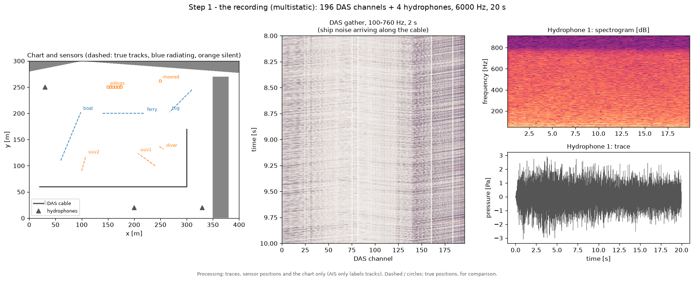
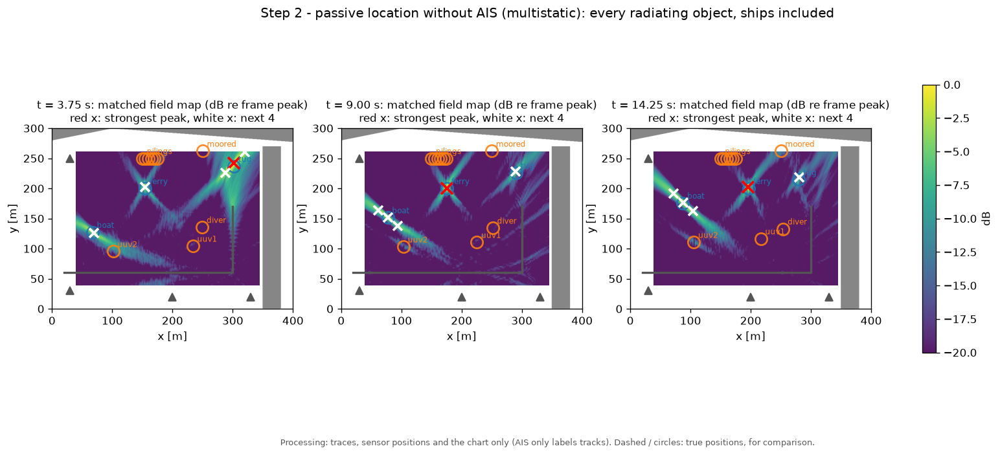
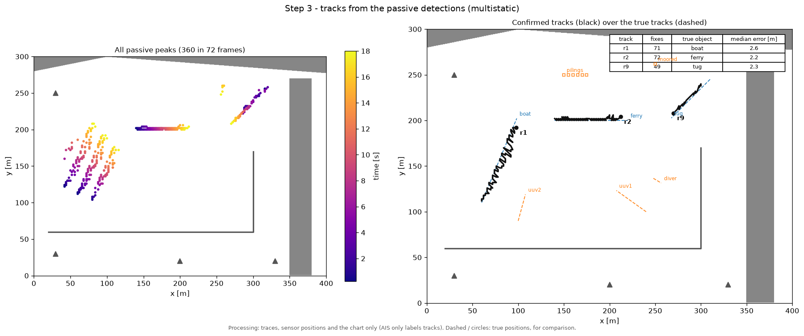
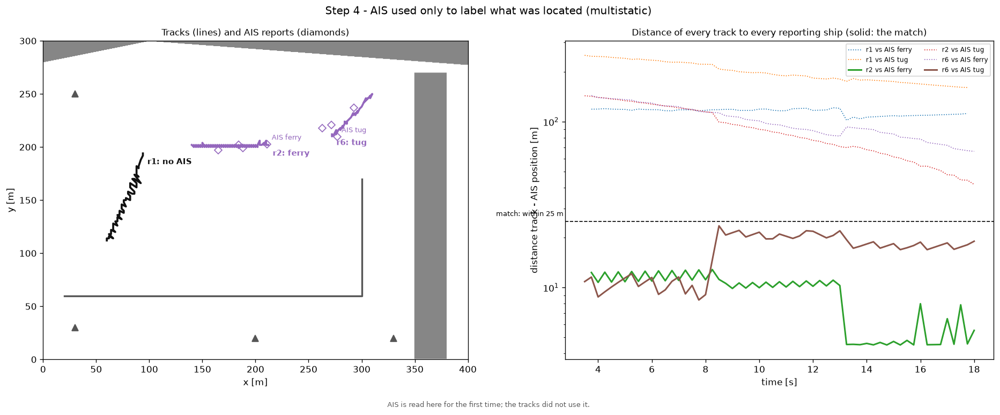
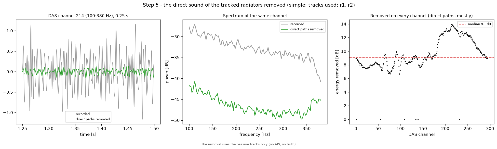
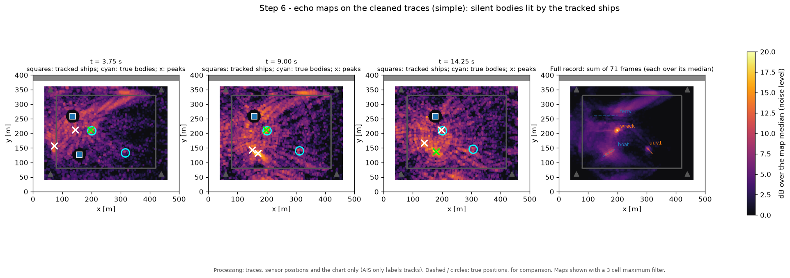
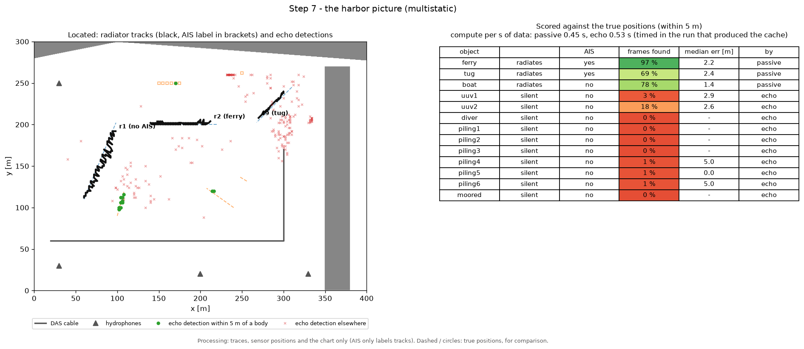

# Harbor: DAS + hydrophone detection of hidden submerged objects

A 2-D synthetic harbor in which fiber-optic cable (DAS) and hydrophones
record ship and target signals. The scenario supports AIS-reporting
vessels, multiple non-AIS targets (UUVs and a diver), and passive
scatterers. It includes both passive matched-field detection of a
target's own emission and bistatic localization of a silent body from
the echo of an AIS ship. The forward model reuses this package's FDTD
solver; water-specific code lives in `src/acoustic_sim/water/`.

**Status: the simulation, sensing and processing chain work and are tested.  The real-time system
(`water/streaming.py`, `examples/harbor_stream.py`, 0.67 to 0.87 s of compute per second of data)
locates every ship from the traces alone, AIS only labelling the tracks afterwards, and finds a silent
UUV lit by one ship in 75 % of frames.  Not yet detected reliably: the silent bodies of the multi ship
scene (6 to 14 %) and the quiet UUVs of the 5 m harbor.**  See
[What the chains find today](#what-the-chains-find-today).

## Walkthrough: from the traces to the harbor picture

`examples/walkthrough/` takes one recording through the whole real-time chain, one figure per step
(`./examples/walkthrough/run_all.sh <bistatic|multistatic|harbor> --cuda`; each script also runs on its
own). The chain runs once (about 30 s on the GPU) and is cached in `output/walkthrough/<dataset>/cache/`;
the figures go to `output/walkthrough/<dataset>/`. Nothing in the processing reads the truth or the AIS
reports: the truth is drawn (dashed lines, circles) only to show where the objects really are, and AIS
enters in step 4 only, to name what was found. The figures below are the multistatic recording (three
ships, two UUVs, a diver, six pilings and a moored hull) and, for the echo steps, the [simple
harbor](#simple-harbor-easier-wavefields) (a ferry and a boat lighting a silent UUV and a wreck).

**1. The recording** (`01_recording.py`). What the system gets: the chart, the sensor positions (a strain
DAS cable and four hydrophones) and the traces.



**2. Passive location** (`02_passive_map.py`). Every 0.25 s the matched field processor steers the array at
every cell of the scan grid; a radiating object lights up. The 5 strongest peaks of each frame are the
passive detections. Ships are located like everything else, without their AIS reports.



**3. Tracks** (`03_tracks.py`). Peaks that follow on in space and time become tracks; a track is confirmed
after 6 fixes in 2 s, and one that sits next to a stronger track (a sidelobe) is dropped. Each confirmed
track is checked against the nearest true object.



**4. AIS afterwards** (`04_ais_crosscheck.py`). Only now are the AIS reports read: a track within 25 m of a
reporting ship takes its name; a track that matches no report is a radiating object without AIS (here the
boat).



**5. Removing the ships' own sound** (`05_direct_path_removal.py`). A silent body is seen only by the ship
noise it reflects, 10 to 20 dB below the ship's direct sound. For every strong track the chain forms a
reference beam toward it and removes the delayed copies of that reference from every channel (ECA,
delays following the track).



**6. The echo map** (`06_echo_map.py`). On the cleaned traces every cell is tested as a reflector of each
tracked ship's sound; the wreck lights up in every frame, the UUV in some, and both stand out in the sum of
the record (each frame over its median, so the scale is dB over the noise level).



**7. The harbor picture** (`07_harbor_picture.py`). Tracks and echo detections over the true positions,
and each object's score (frames with a detection within 5 m, median error). On the multistatic recording
the ships are found in 85 to 96 % of the frames; the silent bodies there are mostly not (6 % and 14 % for
the UUVs) because the other ships' direct sound is removed only by 3 to 7 dB.



All four recordings (bistatic, multistatic, simple, harbor) have the full set of figures in
`output/walkthrough/` (the 5 m harbor without steps 5 and 6).

## Scenario

| Item | Default |
|------|---------|
| Domain | 2400 m x 1800 m, 5 m grid, c is approximately 1492-1500 m/s (effective speed varies with shore distance) |
| Land | Pressure-release walls (opaque, thin breakwaters block sound) plus a lossy layer in the water next to the shore (`shore_loss_width`, `shore_loss_max`; approximate amplitude reflection R ~ 0.5 in the default runner configuration) |
| Sensors | One cable (10 m channel spacing, multiple bends) and 4 hydrophones. The default cable is pressure mode; scenario files can select strain mode and a gauge length. |
| Vessels/bodies | AIS ferry, tug and moored ship; non-AIS `uuv1`, `uuv2`, and diver; stationary `static_scatter` body. See `examples/harbor.scenario.json`. |
| Noise | Colored ambient, three distant-shipping plane waves, DAS channel noise, common-mode noise, 8.6 % gain scatter, 2 % dead channels |
| Band | 12-78 Hz at 600 Hz sampling |

Source levels are calibrated free-field rms pressure at 100 m [Pa]. The passive detector's
default band is 12-78 Hz; the actual source spectrum is limited by grid spacing and sampling.
UUV signatures are sparse tonal signals with little broadband energy; ship signatures are
broadband with speed-dependent level and tonal components.

The bistatic example uses a **different, cropped fine-grid scenario** in
`examples/harbor_bistatic.scenario.json`: it sets a 0.5 m grid, 6 kHz sample rate, strain-mode
DAS with 2 m channel/gauge spacing, a ferry illuminator and a silent 1 m × 3 m UUV body. Its
`--coarse` option changes to 1 m spacing and scales the sample rate/band. Do not infer its
settings or resource cost from the default 5 m / 600 Hz harbor scenario.

### Simple harbor (easier wavefields)

`examples/harbor_simple.scenario.json` (`environment.kind = "simple"`, `water.environment.build_simple_harbor`)
is a harbor built so that its wavefields are easy to resolve, for developing and checking the processing:

| Item | Simple harbor |
|------|---------------|
| Domain | 500 m x 400 m basin, 1 m grid, 3 kHz, 20 s; band 100-380 Hz (wavelengths 4-15 m) |
| Land | One straight 20 m quay along the north edge (a single reflector, one clean image); open water elsewhere, absorbed by the 40 m sponge |
| Sound speed | 1500 m/s everywhere (no shallow water slowdown): the chart's single sound speed is the true one |
| Sensors | A pressure mode DAS loop around the scene (80-420 m x 80-330 m, 4 m channels, 299 channels: every angle covered, no strain directivity) and four corner hydrophones |
| Objects | AIS ferry (1.0 Pa) crossing the north; a boat without AIS (0.3 Pa); a silent 6 m x 2 m UUV; a static 4 m wreck, all inside the loop and 50 m or more apart |

Build it with `python examples/harbor_multistatic_dataset.py --config examples/harbor_simple.scenario.json
--out output/harbor_simple --cuda` (four FDTD runs, 24 s on the GPU); it writes `output/harbor_simple/fine/`.
On the median DAS channel the ferry's echo is 15.7 dB below its direct sound and 1.2 dB above the noise
(`levels.json`). The real-time system (`harbor_stream.py --dataset simple --echo`), everything estimated:
the ferry within 5 m in 100 % of frames (track 1.4 m), the boat in 78 % (0.9 m), the wreck by its echo in
100 % and the UUV in 18 %, at 0.62 s of compute per second of data.

## Physical and Interpretation Limits

This is a **2-D plan-view scalar pressure model**, not a 3-D shallow-water solver. The depth map
is informational; distance from shore is used to derive a small effective sound-speed drop.
Land cells are pressure-release boundaries. Shore loss is a numerical damping ramp that limits
ringing, not a measured seabed absorption law. The pressure-only solver has no rigid Neumann hull
boundary; `Scatterer` bodies use smooth pressure masks (soft/pressure-release or absorbing
approximations). Body geometry should span multiple grid cells for meaningful shape resolution.

The dataset builder caches each radiating vessel's unit-level FDTD gather and then mixes levels
and noise linearly. Scattering is represented by a run with a body minus the matching run
without it; by default each body is run on its own, so multiple scattering between distinct
bodies is not included. `render_vessel_gathers(combined_bodies=True)` (the multistatic dataset)
instead runs every radiating vessel once with all the bodies present and once with none, which
keeps the multiple scattering but loses the per body split.

## Modules (`src/acoustic_sim/water/`)

| Module | Role |
|--------|------|
| `scenario.py` | `HarborScenarioConfig` (the JSON scenario), `build_environment`, `build_layout`, `default_vessels` |
| `environment.py` | Land mask, depth, sound speed; `build_synthetic_harbor` |
| `sensors.py` | `Cable`, `SensorLayout` (including `collapse` of strain sample points) |
| `fdtd_runner.py` | `HarborFDTDConfig`, `HarborFDTDSolver` (land + shore loss on top of the shared `FDTDSolver`), `HarborFDTDBatch`, `simulate_source(s)` with an on-disk cache |
| `fdtd_cuda_bodies.py` | Moving body masks evaluated on the GPU (`HarborFDTDConfig.body_masks="device"`) |
| `signatures.py`, `vessels.py`, `ais.py`, `noise.py` | Signatures and level calibration, trajectories, AIS reports and a predictor, noise and sensor imperfections |
| `dataset.py` | One cached FDTD job per vessel, mixed linearly with noise and AIS into a `HarborDataset`, saved as `<name>.observation.npz` and `<name>.truth.npz` (see [Sensing contract](architecture.md#sensing-contract)) |
| `detection.py` | Whitened STFT, matched-field scan, stationary-interference projection, sidelobe-cancelling peak extraction, CFAR threshold |
| `suppression.py` | AIS-aware suppression: per-frame position refinement, ship projection (model or data-adaptive), re-whitening |
| `occupancy.py` | Occupancy-grid track-before-detect |
| `bistatic.py` | `BistaticConfig`, `run_bistatic`, `eca_stage`: ship-illuminated echo maps, data or true waveform references, direct-path removal, and Bartlett/coherent/MVDR/MUSIC processors |
| `motion.py` | `motion_integrate`: motion compensated (synthetic aperture) integration of the per frame maps (re-exported by `bistatic.py`) |
| `cylinder.py` | Analytic 2-D cylinder scattering (partial wave series) used by the bistatic link budget |
| `scatterer.py` | Smooth moving finite-size body masks used by the FDTD runner |
| `dispersion.py` | `DispersionModel`: the FDTD scheme's numerical wavenumber (forward side) |
| `propagation.py` | `FreeFieldPropagator` and `green2d`: the replica model from the chart alone, default of every chain |
| `diagnostics.py` | `SimulatorAwarePropagator` (dispersion corrected replicas, built from the `Truth`), `VesselPathLocaliser`, `true_illuminator_waveform`: forward model knowledge on the inference path, flagged in the provenance |
| `localiser.py` | Optional empirical replica refinement from a survey grid (`VesselPathLocaliser` in `diagnostics.py` uses the dataset's own vessel gathers) |
| `evaluate.py`, `classifier.py` | Scoring against the `Truth` (`score_detections`, `truth_labels`); optional harbor CNN/CVAE classifier wrapper (`classifier.py` needs the `[ml]` extra) |
| `plotting.py` | Harbor figures |
| `device.py` | CPU / GPU selection |

`acoustic_sim.harbor` is a compatibility alias: `acoustic_sim.harbor.<module>` is the same module object
as `acoustic_sim.water.<module>`.  New code should import from `acoustic_sim.water`.

Because the wave equation is linear, each vessel is simulated once at unit level and cached;
level sweeps and removing a vessel need no re-simulation (`assemble_dataset(levels=...)`).

## Processing chain

1. **Pre-process:** channel QC, per-cable common-mode removal, Hann STFT, per-channel noise floor
   (time median, then a running median across frequency) and whitening.
2. **AIS-aware suppression** (optional, `run_ais_aware`): predict each reporting ship, refine its position
   with a fine Bartlett search, project its replica patch (or the data-adaptive subspace) out,
   and **re-estimate the noise floor from the cleaned data and re-whiten**.  Skipping the
   re-whitening leaves the floor inflated by ship energy and hides the target (it cost a factor
   of ~200 in the matched output at the UUV's tone).
3. **Matched-field scan:** free-field 2-D Green's function replicas over a grid, with a
   per-bin stationary-interference projection and a sparse spectral sum.  An optional
   line-enhancement step subtracts a running median across bins.
4. **Extraction:** non-maximum suppression and successive cancellation (sidelobes of an
   accepted peak are projected out before the next candidate is scored).
5. **Occupancy filter:** diffuse, multiply by a likelihood from each frame's map, repeat.

Without step 2 (`harbor_m3_detect.py`, or `harbor_m4_dlc.py --no-suppress`) the loud ships hide
the UUV.

## Bistatic Echo Localization

The bistatic path treats a reporting ship as an illuminator and searches for a body from its
scattered return at the DAS/hydrophone receivers. It is distinct from passive UUV emission
detection: the target can be silent, and the processor must separate the ship's direct path
from its echo.

`bistatic.py` performs a band-limited STFT, refines the ship location from AIS, obtains a
per-frame illuminator reference (`reference="data"` or, given from the truth, `"true_waveform"`), optionally
removes the direct ship signal, then forms a scan map. Supported map processors are `bartlett`,
`bartlett_phat`, `coherent`, `mvdr`, and `music`. Direct-path removal choices include `eca`,
`patch`, `adaptive`, `patch+adaptive`, and `none`. The method and reference options are not
interchangeable performance guarantees; they are algorithm variants to compare in simulation.

Replicas are evaluated at the layout's actual field sample points. `SensorLayout.collapse`
converts the three samples per strain channel into the second difference measured by that
channel, so the strain response is included in the bistatic steering model.

The runnable FDTD bistatic demo is intentionally given information from the truth to isolate the
echo localization question: it subtracts the known direct ferry component, uses the true ferry
waveform and exact track, and measures the scattered component. Its figures and output state
these assumptions. This is a controlled upper-bound/algorithm demonstration, **not** an end-to-end
detection result with everything estimated from the traces. For a less optimistic view, compare it with the empirical
`reference="data"` and direct-path-removal variants in `bistatic.py`, or use the analytic
prototype as the known-replica reference.

The `harbor_bistatic_budget.py` script is analytical only (no FDTD): it compares idealized
soft/rigid infinite-cylinder scattering with a simplified link budget before launching an
expensive simulation. The rigid-cylinder case belongs to that theoretical budget and is not
implemented as a rigid-body FDTD boundary. It writes `budget.json`, `budget.png` (required
direct-path cancellation along the track for each grid, ship spectrum and cylinder model; best
receiver solid, median dashed, unclipped so values below 0 dB show remaining headroom) and
`budget_geometry.png` (plan view of the mid-track paths and the direct, echo and noise band
levels along the DAS cable). `--n-fig` sets how many track positions the curves use.

## GPU

`ProcessingConfig(use_cuda=True)`, `OccupancyConfig(use_cuda=True)`, `BistaticConfig(use_cuda=True)`
and `HarborFDTDConfig(use_cuda=True)` run the processing and the FDTD on the GPU (CuPy,
`pip install cupy-cuda12x`).  The passive chain runs in single precision on the GPU; the bistatic
chain and the FDTD run in double precision (`HarborFDTDConfig.precision = "float32"` is opt in).
CPU and GPU agree: the passive scan maps correlate at 1.000000, the FDTD traces of the fused kernel
are identical to the array code to the last bit, and the bistatic maps agree to 1e-12 (the ECA to
1e-8, see [Performance](#performance)).  Measured on a Quadro RTX 4000 (8 GB, Turing, float64 at
1/32 of the float32 rate) with the fused kernel (the default on the GPU since the performance work):
a 20 s fine grid vessel run (0.5 m, 6 kHz, 120 000 steps, 481 000 cells) takes 11 s alone and 17 s
with ten bodies, against 3 min and 8 min with the array code and about 8 min on the CPU; the
`all_estimated+doppler+smooth4` bistatic configuration on the fine dataset takes 54 s on the GPU in the
final benchmark run (`final.json`; 47 s in the separate `stage5_gpu.json` run) against 522 s for
the original CPU code.  These are measurements on that specific GPU and scenario, not
portable runtime guarantees; unavailable CUDA hardware falls back to the CPU with a warning.

## Performance

Branch `performance` (October 2026).  Goal: an order of magnitude less compute for the harbor
forward model and the processing chain with no change of results beyond stated tolerances.  Every
change is measured twice by `scripts/bench_harbor.py`: wall time against the original code and
accuracy against the outputs the original code produced (saved once, gitignored).  All numbers below are on the Quadro RTX 4000 (`output/performance/*.json`; the baseline is
`baseline.json`, from commit `ca42d55`). The refreshed final run used Python 3.13.13 / NumPy 2.4.3;
the original baseline used Python 3.12.3 / NumPy 2.5.4, so the end-to-end ratio is indicative, not
a strictly controlled same-interpreter comparison. The stage 0 cases:
the fine bistatic scenario (0.5 m, 6 kHz, 801 x 601 cells), the moving ferry alone for 2 and 10 s
and with the 1 m x 3 m UUV body, the multistatic scene (ferry with all ten bodies) for 2 s; the
`direct_removed_exactly`, `true_waveform_exact_track+doppler` and `all_estimated+doppler+smooth4` configurations of
`harbor_bistatic_ablation.py` on the fine dataset (79 frames); `eca_stage` on the stage 0a 193 m
moving case with fixed lags and with per sample delays (4 s track fit).

### Timing, before and after

Forward model (one run; `ms/step` in brackets):

| Case | original (array code, GPU; `baseline.json`) | fused float64, host masks (`stage1_fused64.json`) | defaults now: fused float64, device masks (`final.json`) | fused float32, host masks (`stage1_fused32.json`) |
|---|---|---|---|---|
| ferry alone, 2 s | 20.7 s (1.72) | 1.26 s (0.105) | 1.81 s (0.151) | 0.64 s (0.053) |
| ferry alone, 10 s | 93.2 s (1.55) | 5.6 s (0.093) | 8.62 s (0.144) | 2.3 s (0.038) |
| ferry + UUV body, 2 s | 25.0 s (2.08) | 2.7 s (0.225) | 1.98 s (0.165) | 3.0 s (0.254) |
| ferry + UUV body, 10 s | 119.9 s (2.00) | 19.4 s (0.324) | 9.56 s (0.159) | 20.2 s (0.337) |
| multistatic, 10 bodies, 2 s | 49.1 s (4.09) | 32.2 s (2.68) | 2.60 s (0.217) | 31.8 s (2.65) |

The float32 column still uses the host masks for the bodies, which is why its body cases are no
faster.  The stage 2 run itself (`stage2_device.json`) measured the device masks faster than the
final run on four of five cases (for example 1.21 s and 1.68 s for the 2 s ferry and multistatic
cases); the table reports the final run.  Time per step against body count (`fdtd_sweeps.json`, 2 s runs): array code 1.82 / 1.54 /
4.57 ms for 0 / 1 / 10 bodies, fused kernel with host masks 0.10 / 0.25 / 2.82 ms, fused kernel with
device masks 0.10 / 0.10 (one outlier run at 0.60) / 0.14 ms.  The fused float64 step on the fine
grid moves about 23 MB through memory in 0.1 ms, close to the card's bandwidth; the remaining cost
of a 20 s run with bodies is the second launch per step for the masks.

Batched runs (stage 3, `fdtd_sweeps.json`, B copies of the 2 s ferry run in one
`HarborFDTDBatch`): 3150, 3080, 3220, 3310, 3180 and 2570 runs per hour for B = 1, 2, 4, 8, 16, 32
(the free memory allowed 32).  Every batched run equals its single run to the last bit.  On this
grid batching does not raise throughput, because the single run is already bandwidth bound rather
than launch bound; it removes the Python launch overhead for small grids and it is what
`render_vessel_gathers` and the stage 0a script now use (the two 20 s runs of the fine dataset
rebuild in 26 s together).

Processing (`run_bistatic` wall time, and `eca_stage` alone):

| Case | original (CPU) | vectorized, CPU | vectorized, GPU (`use_cuda=True`) |
|---|---|---|---|
| `direct_removed_exactly` | 364 s | 230 s | 15.5 s |
| `true_waveform_exact_track+doppler` | 370 s | 294 s | 102.0 s |
| `all_estimated+doppler+smooth4` (dispersion corrected replicas) | 522 s | 394 s | 54.1 s |
| `all_estimated+doppler+smooth4`, free field replicas (everything estimated) | — | — | 35.3 s (not a benchmark run: shared GPU, `ablation_freefield/smooth4/results.json`) |
| `eca_stage`, 193 m moving, fixed lags | 22.2 s | 22.4 s | 15.1 s |
| `eca_stage`, 193 m moving, per sample delays | 28.7 s | 25.0 s | 14.4 s |
| `ship_positions` refinement, 193 m case (39 frames) | 98 s | 70 s | 3.1 s |

On the CPU the vectorization removes redundant work (the scan grid geometry was recomputed for
every bin because the per frame path calls evicted the single entry cache; the replicas of all
bins of a refinement frame now come from one Green's function call) but not the arithmetic, which
is the Green's function evaluation and the matrix products.  On the GPU the ECA is bound by the
float64 matrix products of the normal equations (about 1.4 Tflop per 20 s run at 1/32 rate), which
is why `eca_stage` gains less than the maps; a Toeplitz form of the normal equations would remove
that cost and is left for later.

Total on the stage 0 benchmark (all cases, forward model and processing): 1615 s with the original
code against 226 s with the corrected defaults on the GPU (`final.json`), a measured ratio of 7.2.
This does not reach the order-of-magnitude goal. The true-waveform Doppler accuracy fallback and the
interpreter mismatch above both affect this total; establish a same-interpreter baseline before
using this ratio as a deployment estimate.

### Accuracy and criteria

| Stage | Criterion | Result | Pass |
|---|---|---|---|
| 1 | fused float64 traces within 1e-12 relative per channel of the array code | identical (0.0) on four cases, 2.1e-13 max on the ten body case | yes |
| 1 | fused float32 direct traces within 1e-4 (median) and 1e-3 (max) of float64 | median 3.2e-5 to 3.7e-5; max 1.03e-3 (ferry 2 s), 6.6e-4, 6.2e-4, 6.4e-4, 7.0e-4 | **no** (max, one case, by 3 %) |
| 1 | fused float32 scattered field within 1e-3 of its rms | 6.7e-4, 5.8e-4, 6.6e-4 | yes |
| 1 | fused float32 stage 0a ECA depths within 0.5 dB | 0.00 dB (median), 0.0008 dB max per channel | yes |
| 1 | fused float32 `all_estimated+doppler+smooth4` (dispersion corrected replicas) estimates within one map cell in 95 % of frames | 100 % identical | yes |
| 2 | device masks within 1e-12 of `body_factor`; scattered traces within 1e-10 of the stage 1 run | masks 1.1e-16 (tests); traces 3.7e-13 max | yes |
| 3 | batched runs within 1e-12 of single runs | identical (0.0) for B up to 32 | yes |
| 4 | a CPML thickness at least 10 dB below the sponge in every band and angle | 15 cells, cubic profile: 20.5 dB (peak), 16.5 dB (worst band) margin | yes |
| 5 | vectorized outputs within 1e-10 of the original code, float64 | CPU: maps identical (3e-18 to 1e-15), ECA identical (0.0); GPU: maps 5e-14, 4.7e-14 and 4e-13, ECA 2e-14 (fixed lags) and 2e-12 (per sample delays) | **yes** |
| 6 | a 1 m scheme within 0.1 rad at 400 to 600 m over 100 to 760 Hz, wall error no worse than the 0.5 m scheme | k-space: 0.50 rad (axis), 1.05 rad (diagonal) over the full band; exact (0.001 rad) over 100 to 380 Hz | **no** |

Float32 fails the direct trace criterion on one of five cases by 3 % of the limit, so float64 stays
the default (`precision="float32"` is available and is 2 to 2.5 times faster per step without
bodies; its ECA depths and position estimates on the stage 0 cases are unchanged).

The GPU ECA's batched normal equations can be ill conditioned for the true waveform with per-sample
Doppler delays: with loading of 1e-14, cuSOLVER and LAPACK can produce materially different
projections. That specific configuration now uses the vectorized NumPy/SciPy solve while the rest
of the chain remains on the GPU; its map agrees to 4.7e-14. The fallback raises that benchmark
configuration from 41.2 s to about 102 s in the refreshed full run (102.0 s in `final.json`; 108.8 s
in the separate `stage5_gpu.json` rerun), still below its 370 s baseline. Other GPU ECA cases remain
batched on device: with the data reference (the configurations with everything estimated) cleaned traces agree to
2e-14 (fixed lags) and 2e-12 (per-sample delays), with no change of ECA depth or estimate. On the
CPU, the vectorized ECA keeps SciPy's factorisation and reference call sequence per channel and is
identical to the last bit on every stage 0 case.

CPML (`cpml_reflection.json`, open water, source and receivers 40 m from the edge, 0.5 m grid,
peak of the reflected field re the incident, dB; incidence 0, 27, 45, 63, 76, 82 degrees):

| Boundary | 0 | 27 | 45 | 63 | 76 | 82 | worst band, worst angle | ms/step (3.9 M cells) |
|---|---|---|---|---|---|---|---|---|
| sponge, 60 cells (current) | -76 | -51 | -35 | -19 | -8 | -4.5 | -3.0 | 0.74 |
| CPML 10 cells, quadratic | -70 | -47 | -46 | -45 | -45 | -26 | -24 | 1.06 |
| CPML 10 cells, cubic | -87 | -64 | -61 | -57 | -47 | -28 | -26 | 1.04 |
| CPML 15 cells, cubic | -101 | -81 | -82 | -76 | -43 | -25 | -23 | 1.04 |
| CPML 20 cells, cubic | -111 | -91 | -92 | -75 | -39 | -23 | -21 | 1.04 |
| CPML 30 cells, cubic | -124 | -105 | -104 | -66 | -35 | -21 | -19 | 1.08 |

The current sponge is nearly transparent at grazing incidence (its reflection at 82 degrees is
-4.5 dB), which the stage 0a results never saw because the sources sat in the middle of the crop.
The CPML costs about 40 % more per step (the memory variables of the layer cells) and thins the
boundary from 60 to 15 cells: on the fine harbor grid that is 601 x 801 against 511 x 711 cells, a
quarter of the cells, if the scenario were laid out for it.  The complex frequency shift
(`cpml_alpha_max`) made no difference here.  The sponge stays the default: switching changes the
forward model's output (the spurious reflections it removes are in every existing dataset and
cache), so the change belongs to a scenario revision, with `HarborFDTDConfig(boundary="cpml",
cpml_width=15, cpml_order=3)` recommended for new scenarios (the defaults when `boundary="cpml"` is
set alone are `cpml_width=15`, `cpml_order=2`).

Time stepping (`timestep_schemes.json`, `scripts/bench_timestep.py`; stationary source in open
water, receivers on grid nodes at 100 to 600 m on the axis and the diagonal, time gated, phase of
the transfer function over the analytic `H0^(2)(k r)` referred to the 100 m receiver; wall: a
pressure release half plane on a node line, reflected over direct against the image solution):

| Scheme | grid | ms/step | phase error 400 to 600 m, 100 to 760 Hz (axis / diagonal) | same, 100 to 380 Hz | wall, 100 to 760 Hz | wall, 100 to 380 Hz | cost per simulated second |
|---|---|---|---|---|---|---|---|
| leapfrog, free field k | 0.5 m | 0.81 | > pi / > pi | > pi / > pi | > pi | 0.68 rad | 4.8 s |
| leapfrog, dispersion corrected (current processing) | 0.5 m | 0.81 | 0.001 / 0.048 rad | 0.000 / 0.002 rad | (same run) | (same run) | 4.8 s |
| lw4 | 0.5 m | 1.37 | > pi / > pi | 1.7 / 0.25 rad | > pi | 0.18 rad | 8.2 s |
| k-space | 0.5 m | 8.3 | 0.000 / 0.000 rad | 0.000 / 0.000 rad | 0.31 rad | 0.15 rad | 50 s |
| leapfrog, corrected | 1 m | 0.20 | > pi | 0.018 / 0.036 rad | > pi | 2.6 rad | 0.6 s |
| lw4 | 1 m | 0.35 | > pi | > pi | > pi | 3.1 rad | 1.1 s |
| k-space | 1 m | 1.78 | 0.50 / 1.05 rad | 0.000 / 0.001 rad | 3.0 rad | 0.31 rad | 5.3 s |

The k-space update is exact where the grid resolves the wave: on the 1 m grid it is exact up to
380 Hz (four cells per wavelength) and its wall error there, 0.31 rad at every normal receiver,
is an effective wall position a tenth of a cell beyond the land node line, half the 0.5 m
leapfrog's error in that band.  Up to 760 Hz the 1 m grid has two cells per wavelength and no
scheme meets the criterion: the k-space propagation is still exact, but a point source and a point
receiver on such a grid are not the continuum's (the diagonal error is a constant 1.04 rad at every
range), and the leapfrog's wall numbers over the full band are its own dispersion over the extra
path.  The fourth order time stepping does not help at these resolutions: the spatial stencil
error dominates, and it costs 1.7 times the leapfrog step.  The k-space step costs ten times the
fused leapfrog step on the same grid (two float64 FFTs on a card with 1/32 rate float64), so the
1 m k-space run costs 1.1 times the current 0.5 m run per simulated second.  Both schemes stay opt
in (`time_scheme`); the leapfrog remains the default.

### Options and defaults

| Option | Default now | Changed | Note |
|---|---|---|---|
| `FDTDConfig.kernel`, `HarborFDTDConfig.kernel` | `"auto"` (fused on the GPU, array code on the CPU and under MPI) | yes, from `"reference"` | identical results; not in the cache key |
| `HarborFDTDConfig.body_masks` | `"auto"` (device masks with the fused kernel) | new | 1e-13; not in the cache key |
| `FDTDConfig.precision` | `"float64"` | no | `"float32"` opt in (criterion missed by 3 % on one case); in the cache key |
| `FDTDConfig.boundary` | `"sponge"` | no | `"cpml"` opt in, criterion passed; in the cache key when set |
| `FDTDConfig.time_scheme` | `"leapfrog"` | no | `"lw4"`, `"kspace"` prototypes, criterion failed |
| `BistaticConfig.impl` | `"vectorized"` | new | `"reference"` keeps the original loops |
| `BistaticConfig.use_cuda` | `False` | new | GPU chain, double precision; ECA within 2e-12 with the data reference, differs with the true waveform |
| `simulate_sources`, `HarborFDTDBatch` | used by `render_vessel_gathers` and the stage 0a script when the fused kernel is available | new | identical results, same cache keys |

The cache key of a gather ignores `kernel`, `body_masks` and `use_cuda` and includes `precision`,
`boundary` and the CPML and time scheme fields only when they differ from their defaults, so every
cache built before this work stays valid.

## Status and findings

### What the chains find today

Detect once, check every detection against the true positions (`examples/harbor_detect.py`,
everything estimated from the traces, free field replicas, the 3 strongest map peaks per frame as
detections, a hit within 5 m of an object; `output/harbor_detect/<dataset>/`). The seed 0 mix of
each dataset.

| Dataset | Chain | Found (frames with a detection within 5 m, median error) | Not found | Detections > 10 m from every object | Time |
|---|---|---|---|---|---|
| bistatic (0.5 m, 20 s) | echo, ferry illuminates | silent UUV 75 %, 2.5 m | — | 1.7 per frame | 27 s |
| multistatic (0.5 m, 20 s) | passive | boat (no AIS) 77 %, 1.6 m; ferry 18 %, 1.1 m | tug | 1.8 per frame | 11 s |
| multistatic | echo, ferry illuminates | — (tug 23 %: its direct path dominates the map) | both UUVs, diver, six pilings, moored hull | 2.0 per frame | 27 s |
| harbor (5 m, 120 s) | passive | ferry 2 %, tug 3 % | moored ship, both UUVs, diver | 2.9 per frame | 9 s |

Not detected anywhere: the second UUV, the diver, the pilings, the moored hull, the radiating UUVs of
the 5 m dataset, and every silent body in the multi illuminator scene, where the direct paths of the
ships that do not illuminate are left in the traces and swamp the echo map.

**Real time, located from the traces alone** (`water/streaming.py`, `examples/harbor_stream.py`). AIS
does not enter the processing: it is used afterwards, to label what was located (`ais_crosscheck`).
The traces arrive in 0.25 s chunks:

1. `StreamingPassive` (no AIS) locates the radiating objects, ships included: the 5 strongest peaks of
   every frame. It is the passive chain made causal: channel QC, noise floors and the stationary
   interference projector over the last seconds only.
2. `RadiatorTracker` turns the peaks into causal tracks (gate, confirmation after 6 fixes in 2 s, a track
   within 30 m of a stronger one is a sidelobe and is not confirmed).
3. `StreamingEcho` takes the tracks scoring at least a quarter of the strongest (`RadiatorTracker.strong`:
   the passive chain also locates the echo of a loud ship off a body, about 10 dB below the ship, and that
   echo must not be removed as a radiator; set on the bistatic and multistatic recordings), removes the
   direct path of each of them in turn by ECA with per sample delays (each with its own reference beam,
   its track fitted over the past 4 s and extrapolated), and maps the echoes with every one of them as an
   illuminator (the coherent `"snr"` maps summed). No quay image lags (`eca_images=False`, measured on the
   bistatic recording: 77 % of frames within 5 m of the UUV without them, 73 % with them, at half the ECA
   cost).
4. The AIS reports label the tracks afterwards.

On the Quadro RTX 4000, checked against the true positions (a detection within 5 m of an object):

| Recording | Compute per s of data (passive + echo) | Passive (no AIS) | Tracks (AIS label afterwards) | Echo |
|---|---|---|---|---|
| bistatic (0.5 m, 20 s) | 0.67 s | ferry 100 %, the UUV's echo 58 % | ferry 1.0 m (AIS: ferry) | silent UUV 75 % |
| multistatic (0.5 m, 20 s) | 0.87 s | ferry 96 %, tug 85 %, boat 86 % | boat 1.3 m (no AIS), ferry 2.2 m (AIS: ferry), tug 2.6 m (AIS: tug) | uuv2 14 %, uuv1 6 %, the other bodies under 2 % |
| harbor (5 m, 120 s) | 0.50 s (passive only) | ferry 50 %, tug 2 % | ferry 13 m (AIS: ferry), tug 8 m (AIS: tug) | — |

Latency: about 1.7 s on the 0.5 m recordings (2 s steps), 1 s on the 5 m one. What made it fit: free field
replicas from fused GPU kernels (phase recurrence, `green2d_bins`, within 1e-14; the strain channel
replicas from the range table, within 7e-6), the interference eigendecompositions batched and spread over
blocks, the ECA on the newest blocks only (`eca_remove(blocks=...)`), its normal equations from prefix sums
(`eca_gram="prefix"`, equal to 1e-15) for all channels at once (`eca_chunk=200`), every illuminator's map in
one pass. The batch coherent map uses the same replicas: 4.9 s instead of 9.2 s on the fine bistatic dataset.

Removing the other ships' direct paths is what lets the echoes through in the multi ship scene: with the
tug's and the boat's direct paths removed exactly (from the truth, a diagnostic) the ferry lit map finds
uuv1 in 39 % and uuv2 in 33 % of the frames; estimated, the removal reaches 7 dB (tug) and 3 dB (boat)
against 20 dB given both the true waveform and the exact track, which is where the remaining gap is.

**Scoreboard (stage 1, partial).** `water/scoreboard.py` implements the definitions of
[Architecture, Scoreboard](architecture.md#scoreboard) and `examples/harbor_picture_stage1.py`
runs it (tuning set seed 0, test set seeds 1 to 5). The run was stopped after the bistatic dataset
and the multistatic passive chain (`output/harbor_picture/stage1/results.json`); with the threshold
at 5 % of object free frames:

| Dataset / chain | Configuration | Pd tuning | Pd test |
|---|---|---|---|
| bistatic / echo | `all_estimated` | uuv1 0.27 | uuv1 0.30 |
| bistatic / echo | `true_waveform_exact_track` (given the truth) | uuv1 0.03 | uuv1 0.02 |
| bistatic / echo | `direct_removed_exactly` (given the truth) | uuv1 0.37 | uuv1 0.51 |
| multistatic / passive (scan map) | `all_estimated` | ferry 0.00, tug 0.00, boat 0.16 | ferry 0.00, tug 0.00, boat 0.08 |
| multistatic / passive (occupancy map) | `all_estimated` | 0.00, 0.00, 0.00 | 0.01, 0.00, 0.01 |

Criteria fixed before the run: 1 (passive, ferry, tug and boat Pd >= 0.9) **fails**; 2 (echo,
bistatic UUV Pd >= 0.5) **fails** (0.30); 3 (multistatic static bodies) was not run. The UUV is the
strongest cell of 89 % of the bistatic frames (median 2.6 m), but its peak exceeds the object free
threshold in only 30 %: the threshold is set by the residual direct path at the ends of the record.
The passive threshold is set by the frames before the first AIS report, where the ships are neither
projected out nor excluded. The direct path of the ferry is removed by 10.8 dB (estimated waveform)
and 21.3 dB (true waveform and exact track), as in stage 0.

### History

#### The passive emission experiment

In the passive-emission experiment summarized here, at the tested UUV level (-30.5 dB re 1 Pa
at 100 m, about 30 dB below the ferry) the UUV is
**not** detected: it is found only when it is about as loud as the ferry (a sweep of the UUV level
with the model-projection chain found it, with a 64 m occupancy error, only at -0.9 dB).
This is a result for that passive-source-emission experiment, not the bistatic echo demo or a
general guarantee about every later scenario configuration. The source level is a first guess,
not a tuned or measured value. Every item below was a single
bounded experiment with a pass/fail criterion fixed beforehand.

| Hypothesis for the ship residual | Measurement | Result |
|---|---|---|
| Ship projection removes the UUV too | Fraction of the UUV replica inside the ship subspace | 5-33 %: not the cause |
| Whitening floor inflated by ships | Matched output at the UUV tone, UUV-only vs all vessels | **Real bug**, fixed by re-whitening (about 200x) |
| DAS gain scatter limits cancellation | Divide out the true gains | No effect (B at the UUV 3.6 -> 3.5) |
| Motion, patch size, assumed sound speed | Ferry-only cancellation depth, real FDTD vs exact free-field control | Real: 3-6 dB in every setting; control: 16-45 dB |
| Shoreline reverberation | Same depth, shore reflection 0.45 / 0.07 / 0.005 | 5.2 / 6.6 / 6.5 dB: not the cause |
| Emission-time (retarded) positions | Retarded per-channel replica positions | Shift 1.2 m, no change (5.2 dB) |
| Harbor geometry and shadowing | Same ferry in an open-water FDTD | 4-8 dB: not the cause |
| **FDTD numerical dispersion** | Stationary source vs analytic Green's function | **Real**: phase error up to 0.8 rad (axis) / 2.5 rad (diagonal) at 800 m, 40-60 Hz, anisotropic |
| Brute-force fix by FD order / sample rate | Order 4/8 at 600/1200 Hz | None reaches 0.1 rad (leapfrog time-stepping error remains) |
| Dispersion-corrected replica (`dispersion.py`) | Same stationary map | **Fixed**: <= 0.102 rad at 400-800 m, both directions |
| ... and the moving ferry | Ferry-only cancellation depth with the corrected replica | Only 5.5 dB (1 s frames), 11.6 dB (2 s, open water): **the criterion (20 dB) was not met** |

#### Stage 0 of the multistatic work (branch `multistatic`)

Goal of the long term work: locate every object in the harbor (radiating vessels, silent moving
bodies, static structures) by passive sensing with ship noise as the illuminator. Stage 0 asks
whether the bistatic chain works with everything estimated from the traces and builds the multi illuminator,
multi body scenario for the later stages. Every result states its truth inputs; every
experiment had its pass/fail criterion in the script docstring and `results.json` before it ran.

**Stage 0a, direct path cancellation against range** (`examples/harbor_cancellation_depth.py`,
fine 0.5 m grid, 10 s, the ferry signature alone at nearest channel ranges of 193, 99 and 29 m,
stationary and at 4 m/s parallel to the first cable leg; ECA depth over the live cable channels
in 100 to 760 Hz; `output/harbor_cancel/`). References: `data` (delay and sum beam at the AIS
refined position, estimated from the traces), `true_waveform` (true waveform, AIS refined position), `true_waveform_exact_track` (true
waveform, exact position). Criterion: median depth with the `data` reference at least 20 dB.
The AIS refinement of every column used the FDTD dispersion corrected replicas (simulator
knowledge, so even the `data` column was not everything estimated); the rows marked *free field replicas* are the
same runs with the free field replicas a deployed system would use
(`--propagator free` at the time, `output/harbor_cancel/freefield/`), and only their `data` column has everything estimated
(the `true_waveform` columns still use the true waveform).

| Source | Range | `data` | `true_waveform` | `true_waveform_exact_track` | `data`, Doppler + 4 s fit | `true_waveform`, Doppler + 4 s fit | `true_waveform_exact_track`, Doppler |
|---|---|---|---|---|---|---|---|
| stationary | 193 m | 8.8 dB | 34.4 dB | 32.9 dB | 8.7 dB | 33.2 dB | 31.5 dB |
| moving 4 m/s | 193 m | 2.3 dB | 5.5 dB | 5.5 dB | 9.2 dB | 21.4 dB | 24.4 dB |
| stationary | 99 m | 18.7 dB | 47.3 dB | 45.1 dB | 19.6 dB | 44.2 dB | 42.2 dB |
| moving 4 m/s | 99 m | 3.4 dB | 3.6 dB | 3.6 dB | 18.9 dB | 22.9 dB | 24.6 dB |
| stationary | 29 m | 7.0 dB | 37.4 dB | 51.0 dB | 11.9 dB | 29.4 dB | 50.6 dB |
| moving 4 m/s | 29 m | 2.7 dB | 2.2 dB | 2.2 dB | 7.2 dB | 14.9 dB | 21.5 dB |
| stationary, free field replicas | 193 m | 5.5 dB | 3.5 dB | 32.9 dB | 10.1 dB | 3.3 dB | 31.5 dB |
| moving 4 m/s, free field replicas | 193 m | 3.5 dB | 5.4 dB | 5.5 dB | 9.2 dB | 10.4 dB | 24.4 dB |
| stationary, free field replicas | 99 m | 19.0 dB | 44.5 dB | 45.1 dB | 19.9 dB | 41.5 dB | 42.2 dB |
| moving 4 m/s, free field replicas | 99 m | 3.4 dB | 3.6 dB | 3.6 dB | 18.8 dB | 19.0 dB | 24.6 dB |
| stationary, free field replicas | 29 m | 7.5 dB | 38.0 dB | 51.0 dB | 11.9 dB | 28.5 dB | 50.6 dB |
| moving 4 m/s, free field replicas | 29 m | 2.7 dB | 2.2 dB | 2.2 dB | 7.3 dB | 15.0 dB | 21.5 dB |

Median ECA depth over the live cable channels (`results.json`, `results_doppler.json`,
`results_doppler_smooth4.json`; the free field rows from the `_freefield` files).
**Criterion failed at every range** (the `data` column never reaches 20 dB, with either replica).
The free field replicas change mainly the 193 m stationary case: the refinement misses the ship by
18 m instead of about 1 m (the numerical dispersion of the 0.5 m grid is several wavelengths of
phase at that range), so the AIS refined `true_waveform` column falls from 34 to 4 dB there. Reading it with the interpretation fixed in advance:

* The stationary source is low at every range with the `data` reference while the `true_waveform`
  reference at the same AIS refined positions reaches 34 to 47 dB, so the removal method is not
  the limit; the reference estimated from the traces is. On the coarse debug case the same beam built from the
  noise free traces gave 19 dB against 8 dB from the noisy ones, and its coherence with the true
  waveform falls from 0.94 at 300 Hz to 0.16 at 100 Hz: the strain response goes as frequency
  squared, so the low end of the band is noise dominated in the beam, and a least squares
  projection on a noisy reference leaves a residual of about one over the reference's signal
  to noise ratio.
* The moving source fails at every range for every reference with the fixed lag ECA (2 to
  6 dB): the direct path delay drifts by `v T / c` inside a 0.5 s block, a full cycle at the
  band top. Per sample delays that follow the ship (`BistaticConfig.eca_doppler`, 8x FFT
  upsampling for the resampling) bring the exact track case to 21 to 25 dB. With the AIS
  refined track the per frame jitter of about 1 m becomes velocity noise (7 to 9 dB) until the
  track is fitted by a local straight line over 4 s (`track_smooth_s`; 15 to 23 dB).
* Near field channels are not the cause: the exact position at 29 m is cancelled by 51 dB.
  What fails at 29 m is the AIS refinement itself (5.6 m error, jumping between frames), so no
  `gate_radius` rerun was made.
* The per channel plots (`depth_per_channel.png`) show the data reference depth rising from 3 dB
  at the channels broadside to the source to 17 dB at the oblique ones (193 m), the true waveform
  20 to 55 dB everywhere.
* The ECA projection is a Cholesky solve of the normal equations with one refinement step (five
  times faster than the QR it replaced); on the stationary 193 m true waveform case it reads 1 dB
  (median) and 3 dB (10th percentile) below the exact QR projection. The criterion column is
  unaffected (8.8 dB either way).

**Stage 0b, the bistatic demo without its truth inputs** (`examples/harbor_bistatic_ablation.py`,
coarse and fine datasets, `output/harbor_bistatic/ablation/`). Configurations: 1 `direct_removed_exactly`
(direct path removed with the truth component, true waveform, exact track: the demo), 2 `true_waveform_exact_track` (direct path in
the traces, removed by ECA; true waveform; exact track), 3 `estimated_waveform_exact_track` (data reference, exact
track), 4 `all_estimated` (data reference, AIS track with refinement). Criterion for `all_estimated` on the
fine dataset: median echo contrast at least 10 dB and at least half the frames within 5 m.
Every configuration of the original run used the FDTD dispersion corrected replicas, so the rows
named `all_estimated` used simulator knowledge. The rows marked *free field (everything estimated)*
are the same configurations with free field replicas and no truth input at all
(`--propagator free --cuda` at the time, `output/harbor_bistatic/ablation_freefield/`); they are the rows of this table with everything estimated from the traces. The committed `results.json` files keep the configuration names of the time.

| Configuration | coarse: median error | within 5 m | 1.5 s within 5 m | contrast | ECA depth | fine: median error | within 5 m | 1.5 s within 5 m | contrast | ECA depth |
|---|---|---|---|---|---|---|---|---|---|---|
| `direct_removed_exactly` | 1.7 m | 90 % | 99 % | 17.8 dB | truth | 2.3 m | 92 % | 100 % | 20.2 dB | truth |
| `true_waveform_exact_track` | 71.2 m | 15 % | 3 % | 16.2 dB | 8.5 dB | 72.5 m | 0 % | 0 % | 18.9 dB | 3.5 dB |
| `estimated_waveform_exact_track` | 84.3 m | 5 % | 1 % | 17.9 dB | 5.6 dB | 89.8 m | 1 % | 0 % | 18.8 dB | 2.2 dB |
| `all_estimated` | 80.8 m | 5 % | 1 % | 16.8 dB | 5.3 dB | 89.8 m | 5 % | 0 % | 18.2 dB | 2.8 dB |
| `true_waveform_exact_track+doppler` | 3.8 m | 54 % | 86 % | 14.8 dB | 25.1 dB | 6.0 m | 48 % | 53 % | 14.9 dB | 21.3 dB |
| `estimated_waveform_exact_track+doppler` | 6.1 m | 42 % | 53 % | 15.3 dB | 14.8 dB | 2.7 m | 68 % | 72 % | 16.0 dB | 12.2 dB |
| `all_estimated+doppler` | 9.2 m | 27 % | 35 % | 15.4 dB | 10.3 dB | 6.8 m | 39 % | 43 % | 16.2 dB | 8.3 dB |
| `true_waveform_exact_track+doppler+smooth4` | 3.8 m | 54 % | 86 % | 14.8 dB | 25.1 dB | 6.0 m | 48 % | 53 % | 14.9 dB | 21.3 dB |
| `estimated_waveform_exact_track+doppler+smooth4` | 6.1 m | 42 % | 53 % | 15.3 dB | 14.8 dB | 2.7 m | 68 % | 72 % | 16.0 dB | 12.2 dB |
| `all_estimated+doppler+smooth4` | 8.5 m | 32 % | 37 % | 15.2 dB | 11.0 dB | 3.8 m | 58 % | 54 % | 16.1 dB | 11.0 dB |
| `all_estimated`, free field (everything estimated) | 78.5 m | 13 % | 1 % | 18.5 dB | 5.0 dB | 86.4 m | 11 % | 0 % | 19.7 dB | 2.8 dB |
| `all_estimated+doppler`, free field (everything estimated) | 67.3 m | 34 % | 43 % | 16.1 dB | 8.7 dB | 62.6 m | 38 % | 33 % | 18.5 dB | 7.3 dB |
| `all_estimated+doppler+smooth4`, free field (everything estimated) | 3.0 m | 62 % | 75 % | 15.5 dB | 11.0 dB | 3.2 m | 75 % | 77 % | 17.3 dB | 10.8 dB |

Per 0.5 s frame (`results.json`, rows above the free field ones: dispersion corrected replicas; the
`+doppler` rows are the same configurations with
`eca_doppler=True`, reported as variants outside the criterion). The coarse `direct_removed_exactly` row
reproduces `demo/demo_summary.json` exactly. **Criterion failed**: `all_estimated` on the fine dataset
has a median contrast of 18.2 dB but only 5 % of the frames within 5 m. The contrast (map peak
over map median) does not discriminate here, because with the direct path cancelled by only 2
to 4 dB the peak sits on the residual direct path, which is just as sharp as an echo. The step
that loses the localisation is **1 to 2**, the fixed lag ECA replacing the truth removal: 92 %
of frames within 5 m become 0 % and the ECA removes 3.5 dB of the moving ferry (the stage 0a
moving source result), with the echo lost by under 1 dB. Steps 2 to 3 and 3 to 4 change
nothing at that point. With per sample delays (`eca_doppler`) the ECA cancels 21 dB (true waveform) and 8 to 12 dB (data reference) and the chain works part of the time: the variant with everything estimated locates the UUV in 39 % of the frames (43 % after 1.5 s integration, median
error 6.8 m), the data reference with the exact track in 68 %. With the refined track also
fitted over 4 s (`track_smooth_s`, the `+smooth4` rows from `ablation/smooth4/`) the variant with everything estimated reaches 58 % of frames within 5 m, median error 3.8 m, contrast 16.1 dB, ECA depth
11 dB: the numbers the criterion asked for, but from a chain changed after the criterion was
fixed, so it is reported as a variant and not as a pass. With free field replicas (the chain with everything estimated, run after the sensing contract made the dispersion replicas visible as simulator knowledge)
the same variant does better, not worse: 75 % of the fine frames within 5 m, median 3.2 m; the
plain `all_estimated` configuration fails the criterion with either replica (11 % within 5 m). The data reference beats the true waveform once the ECA follows the ship, presumably because the beam carries the quay
multipath that the free field image lags only approximate. The per frame estimate fails on the
remaining frames by jumping to a sidelobe (p90 error about 200 m), not by a small miss.

What limits the `all_estimated` configuration, in order: the direct path residual (8 dB of ECA depth
against the 16 to 18 dB the echo sits below the direct path on the median cable channel,
`levels.json`), set by the estimated reference's signal to noise ratio (stage 0a); then the AIS
refined track, whose jitter the per sample delays read as velocity noise (track smoothing
recovers most of it); the echo loss in the ECA is small throughout (0.3 to 1.9 dB).

**Stage 0c, multistatic scenario and dataset** (`examples/harbor_multistatic.scenario.json`,
`examples/harbor_multistatic_dataset.py`, `output/harbor_multistatic/`). Same 0.5 m crop and
sensors as the bistatic scenario with three illuminators (the AIS ferry; an AIS tug crossing
the ferry's geometry from the north east; a small radiating boat without AIS), three silent
moving bodies (`uuv1` and `uuv2`, 1 m x 3 m soft hulls on different headings at 2 and 1.5 m/s;
a diver, 0.5 m x 1 m at 0.5 m/s with 2 m of wander) and seven static soft bodies (a row of six
1 m pilings 5 m apart at y = 250 m, `kind: "static"`; a moored 6 m x 30 m hull by the north
quay). All tracks are at least 15 m from land and outside the 30 m sponge. Each illuminator is
rendered with all ten bodies present and with none (`combined_bodies=True`), so the dataset
carries `direct:<id>` and `scattered:<id>>bodies` per illuminator plus the noise, and
`truth.json` gives every object's type, body, AIS status, position and velocity per frame.

Fine dataset levels on the median live cable channel, 200 to 760 Hz (`levels.json`): echo to
direct ferry -8.1 dB, tug -14.5 dB, boat -11.1 dB; echo to noise
ferry +5.7 dB, tug -0.3 dB, boat -4.7 dB (best channel +13.7, +5.4, +0.5 dB).
The FDTD runs took 38 min on the GPU (fine) and 19 min (coarse, where the sponge is kept at
30 m in metres, unlike the bistatic coarse run). `ferry_only_map.png` runs the bistatic chain given the truth (direct path removed with the truth component, true ferry waveform, exact ferry track)
on the ferry's scattered component alone: in the map summed over the 79 frames every body is
above the map median within 4 m of its position, uuv1 +6.4 dB, uuv2 +8.0 dB, diver +7.0 dB, piling1 +5.5 dB, piling2 +7.3 dB, piling3 +7.3 dB, piling4 +7.6 dB, piling5 +7.6 dB, piling6 +6.4 dB, moored +15.1 dB.
The echoes are there; the per frame maps are dominated by the sidelobe streaks of the strongest
echo, which is the job of the later CLEAN and fusion stages, not of this dataset check.

### Open

The dispersion fix makes a stationary source's replica accurate to <= 0.1 rad, yet the moving
ferry is cancelled by only 5-12 dB.  The ship has to be cancelled by about 31 dB to match the UUV.
What limits the moving ferry is not established.  Unverified candidates: the 10-50 m near-field
channels (the ferry runs parallel to the cable about 30 m away for much of its track, and the
stationary map shows 10-25 % amplitude errors at those ranges), and the representation of a moving
source in the FDTD.  The suggested next experiment is the cancellation depth of a *stationary*
source at 400, 150 and 30 m: low at all ranges points at the moving-source representation, low only
near the cable points at the near-field channels (which could then be gated).

An analytic forward model (free-field channel with a known replica, as in a simple matched-field
demo) would make the technique work by construction; this package currently uses the FDTD only,
by choice.

After stage 0 the moving ferry question above is answered for the bistatic chain: the fixed
lag ECA could not follow the delay drift inside a block, the per sample delays can (21 to 25 dB
with the true waveform and track). What remains open is the reference estimated from the traces: a delay and sum
beam of the strain cable has too little signal to noise ratio at the low end of the band to
cancel the direct path by more than 8 to 19 dB, and the AIS refinement is unreliable within
about 30 m of the cable. Candidates for stage 1: a frequency weighted or iterative reference
(cancel, re-beam on the cleaned data for the next pass), the hydrophones as a pressure
reference, a constant velocity track fit across the whole run instead of per frame refinement,
and gating the near field channels. Multistatic fusion, CLEAN extraction and tracking were
deliberately not started.

## Examples and Workflows

| Script | What it does | Time |
|---|---|---|
| `examples/harbor_m1_demo.py` | Map, one FDTD source run, DAS gather, wavefield snapshots | ~15 s |
| `examples/harbor_m2_dataset.py` | Builds the default multi-vessel labelled dataset and overview figures (cached FDTD) | expensive on first build; reuses cache |
| `examples/harbor_m1_scatterer_compare.py` | Three FDTD runs (no body, "hard" and "soft" body) to isolate the scattered field of a static reflector | three FDTD runs |
| `examples/harbor_m3_detect.py` | Baseline CFAR detection sweeps **without** AIS suppression (the loud ships hide the UUV); `--empirical-refine` uses the `localiser.py` calibration | processing sweep; reuses cache |
| `examples/harbor_survey_grid.py` | Pre-computes per-cell FDTD transfer functions for `harbor_m3_detect.py --empirical-refine grid_survey` (resume-safe cache) | one FDTD run per water cell of the scan grid |
| `examples/harbor_m4_dlc.py` | Detect–locate–classify experiment, noise-only CFAR calibration, optional AIS suppression, CNN/CVAE classification and evaluation | varies; FDTD gathers are cached |
| `examples/harbor_mfp_demo.py` | Analytic (free-field, exact replica) reference for the whole chain: AIS refinement, ferry and pier projection, passive 400 Hz MFP (motor on), bistatic echo MFP (motor off), occupancy track, Bartlett vs MVDR under replica mismatch, Pd vs UUV level. Figures and `results.json` in `output/harbor_demo/` | ~26 min on 16 CPU cores (`--trials 0` skips the Pd sweep: ~4 min) |
| `examples/harbor_mfp_domain.py` | The same analytic chain in the domain of `output/harbor/dataset.npz` (land, cable + hydrophones, 120 s tracks, AIS, signatures, band, noise and DAS gains from the dataset; analytic propagation with opaque land). Adds AIS-ship gain calibration, re-whitening on the cleaned residual, DAS common-mode and distant-shipping plane-wave projection. Figures and `results.json` in `output/harbor_domain/` | ~1 h on 16 CPU cores (`--pd-windows 0`: ~20 min) |
| `examples/harbor_m1_uuv.py` | Single Ricker pulse with and without a stationary finite-size UUV; plots the difference as the scattered field | one FDTD pair |
| `examples/harbor_m1_uuv_video.py` | Animate the pulse and predicted UUV echo on the cable | one FDTD pair |
| `examples/harbor_bistatic_budget.py` | Analytic 2-D bistatic link budget with idealized soft/rigid cylinder models; no FDTD | quick |
| `examples/harbor_bistatic_dataset.py` | Fine-grid FDTD scenario; caches direct and body-scattered components separately | expensive; `--coarse` is faster but under-resolves the hull |
| `examples/harbor_bistatic_demo.py` | Coherent bistatic localization figures given the truth (direct path removed exactly, true waveform, exact track) and error summary from a saved dataset | processing run |
| `examples/harbor_cancellation_depth.py` | Stage 0a: ECA cancellation depth of the ferry signature alone against range, stationary and moving, three references; `--doppler`, `--smooth`, `--gate` and `--propagator` (free field by default, `_freefield` suffix; `simulator` for the dispersion corrected replicas) variants write suffixed outputs | 6 cached FDTD runs (12 min on the GPU) + about 40 min of processing |
| `examples/harbor_bistatic_ablation.py` | Stage 0b: `run_bistatic` on the coarse and fine datasets with the truth inputs removed one at a time (`--doppler` adds the per sample delay ECA variants, `--smooth` the track fit, `--propagator simulator` the dispersion corrected replicas, `--cuda` the GPU chain); every result records its `provenance` | about 1.5 h of processing for both datasets |
| `examples/harbor_multistatic_dataset.py` | Stage 0c: three illuminators and ten bodies with combined scattering, truth per frame, levels, map, and a ferry-only check map given the truth | 6 FDTD runs (fine: about 1 h on the GPU) |
| `examples/walkthrough/` | [Walkthrough](#walkthrough-from-the-traces-to-the-harbor-picture): seven scripts, one figure per step of the chain (recording, passive map, tracks, AIS labels, direct path removal, echo map, harbor picture); `run_all.sh <dataset> --cuda` | about 1 min per recording |
| `examples/harbor_stream.py` | The real-time system (`water/streaming.py`): passive chain without AIS, tracker, echo chain on the tracks, AIS labels afterwards; feeds a recording in 0.25 s chunks, reports compute per second of data and latency, checks every output against the true positions; `--dataset multistatic|bistatic|harbor [--echo] --cuda`; writes `output/harbor_stream/<dataset>/` | 15 to 60 s per run |
| `examples/harbor_picture_stage1.py` | Harbor picture stage 1: the [scoreboard](architecture.md#scoreboard) on the bistatic, multistatic and 5 m harbor datasets, tuning set (noise seed 0) and test set (seeds 1 to 5, remixed from the cached gathers), passive and echo chains; `--dataset`, `--chain`, `--propagator {free_field,simulator}`, `--cuda`, `--workers`; writes `output/harbor_picture/stage1/` | about 1.2 h on the GPU (runs are cached in `cache/`) |
| `examples/harbor_domain_video.py`, `examples/harbor_stack_movie.py`, `examples/harbor_presentation.py` | Visualize passive/bistatic scans, echo stacks, or the scenario pipeline | varies |
| `examples/harbor_train_classifier.py`, `examples/harbor_train_anomaly.py`, `examples/harbor_build_classifier_dataset.py` | Build harbor classification data and train CNN/CVAE models | training workload |

Run times are from the original experiments and are hardware and configuration specific; the first FDTD cache build is the main cost.  [Generated outputs](outputs.md) lists what each script writes and what is committed.

`examples/harbor.scenario.json` is the default scenario (set `"fdtd": {"use_cuda": true}` to
simulate on the GPU). Outputs are written under `output/`; FDTD cache files can be reused between
dataset assembly and experiments.

### End-to-end examples

Run the passive scenario and detection/classification workflow:

```bash
python examples/harbor_m2_dataset.py
python examples/harbor_m4_dlc.py --config examples/harbor.scenario.json --out output/harbor
```

The M4 script can skip AIS suppression with `--no-suppress`, enable GPU processing with
`--cuda`, and accepts `--pfa`, `--cal-seeds`, `--cnn`, and `--cvae` options. Missing classifier
checkpoints are reported as unclassified output rather than preventing the rest of the workflow.
Check each script's `--help` for current flags.

For the cropped strain-DAS bistatic setup:

```bash
python examples/harbor_bistatic_budget.py --out output/harbor_bistatic
python examples/harbor_bistatic_dataset.py --coarse
python examples/harbor_bistatic_demo.py \
    --dataset output/harbor_bistatic/coarse/dataset.npz \
    --out output/harbor_bistatic/demo
```

`--coarse` switches from the default 0.5 m grid to 1 m and proportionally scales the sample
rate/band. It is faster but a 1 m × 3 m body is poorly resolved at 1 m cells. A fine-grid run
uses more compute and storage; cache and output directories are separate from the default
`output/harbor` dataset.

```python
from acoustic_sim.contract import Observation
from acoustic_sim.water.detection import ProcessingConfig, build_grid
from acoustic_sim.water.suppression import SuppressionConfig, run_ais_aware
from acoustic_sim.water.occupancy import OccupancyConfig, OccupancyGrid

obs = Observation.load("output/harbor/dataset.observation.npz")   # or HarborDataset.load(...).observation
pc = ProcessingConfig(win_s=2.0, hop_s=1.0, use_cuda=True)       # free field replicas: nothing beyond the chart
run = run_ais_aware(obs.traces, obs.geometry, obs.fs, obs.environment, obs.reports, pc, SuppressionConfig(),
                    grid=build_grid(obs.environment, pc))
track = OccupancyGrid(run.scanner.grid, OccupancyConfig(use_cuda=True)).run(run.scan.B, run.wh.times)
print(run.provenance.to_dict())
```

Replicas that follow the simulator's grid dispersion are a diagnostic: they need the truth file
(`propagator=SimulatorAwarePropagator.from_truth(Truth.load("output/harbor/dataset.truth.npz"))`
from `acoustic_sim.water.diagnostics`), they model the simulator's grid, not the ocean, and the
run's provenance then lists `"dispersion"`.

For bistatic processing, the corresponding API is `BistaticConfig` and `run_bistatic`:

```python
from acoustic_sim.water.bistatic import BistaticConfig, run_bistatic

bc = BistaticConfig(
    f_lo=100.0, f_hi=760.0, # the processing band: a choice of the processing (here the 0.5 m datasets')
    reference="data",       # "true_waveform" only for controlled experiments; flagged
    removal="eca",
    method="coherent",
)
echo_run = run_bistatic(obs.traces, obs.geometry, obs.fs, obs.environment, obs.reports, bc)
```

`BistaticConfig(propagator=SimulatorAwarePropagator.from_truth(truth))` compensates for the
numerical dispersion of that specific grid/time step; it is simulator knowledge (flagged in
`echo_run.provenance`) and not a model of real-water propagation.

## Tests

`pytest tests/harbor` (156 tests; the GPU variants skip automatically without CuPy / a GPU).
They cover the environment and sensors, the FDTD runner (amplitude against the analytic
Green's function, moveout, linearity, cache, shoreline), signatures, AIS, noise, the dataset
mixer, detection and scoring, ship refinement and projection (including a synthetic scene in
which only the data-adaptive projection removes a multipath ship), the occupancy filter,
dispersion, GPU / CPU parity, the bistatic ECA on an analytic free field case (`eca_stage`
against the inline code it replaced, depth and echo preservation, the Doppler variant on a
moving ship, track smoothing, `run_bistatic` end to end), the combined body gathers, and the
performance paths (`test_performance.py`: fused kernel against the array code in both precisions,
device masks against `body_factor`, batched against single runs, CPML reflection against the
sponge, the lw4 and k-space schemes; `test_bistatic_vectorized.py`: the vectorized ECA,
refinement, maps and motion integration against the reference loops on the CPU and the GPU), and
the scoreboard (`test_scoreboard.py`: threshold at the 5 % quantile, Pd and false alarms by
construction on synthetic maps, a static and a moving object, pilings, pooled seeds).
