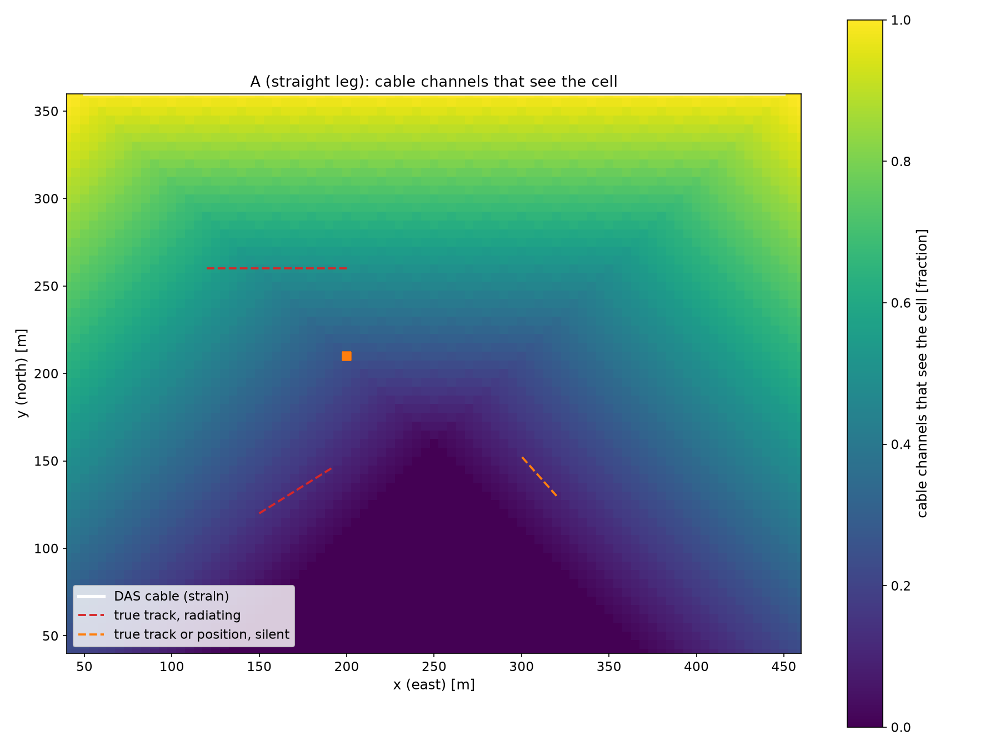
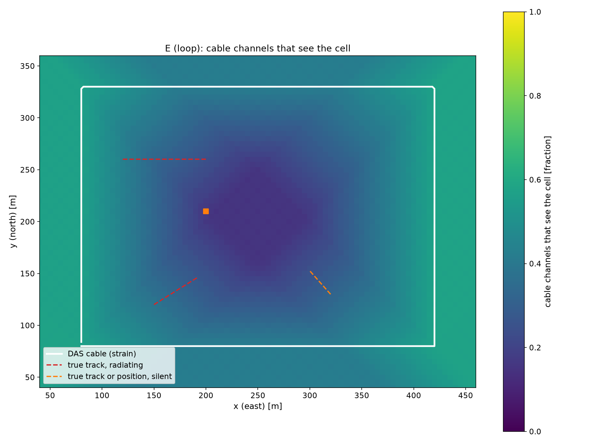
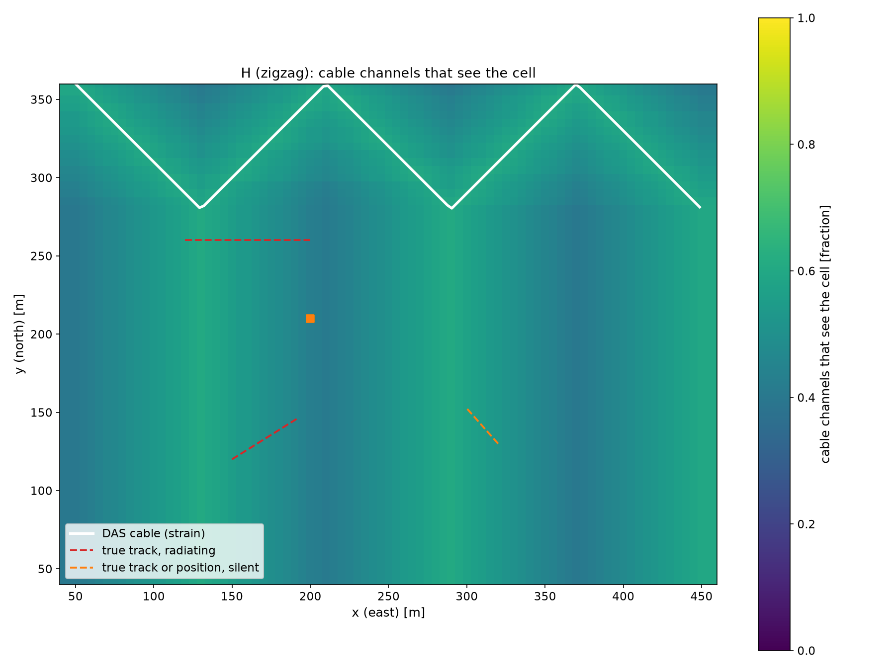
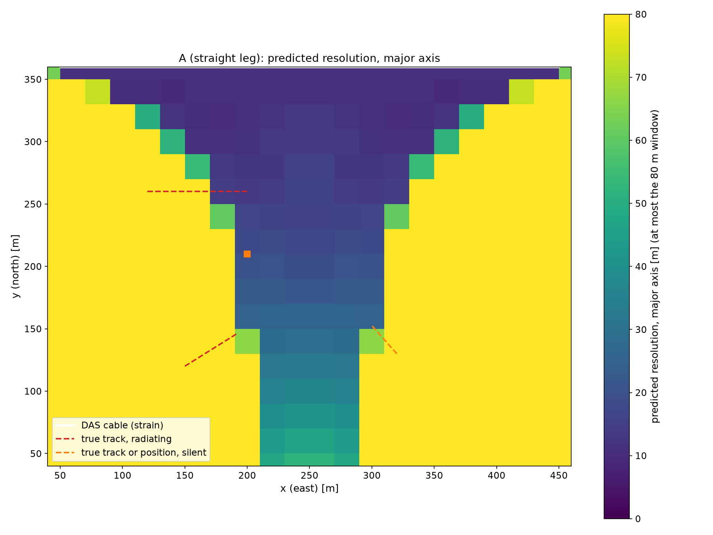

# The sensor layout study

A strain sensing cable responds to a wave as the square of the cosine of the angle between the wave and the fibre, so a
straight leg is deaf broadside; the hydrophones are omnidirectional but are a handful of channels among a few hundred.
Where the cable runs, how many bends it has and how many hydrophones fill its blind directions decide what the system
can see before any processing runs. This page measures it on one scene with nine layouts.

## Coverage without running anything

`acoustic_sim.water.coverage` (processing side: the chart, the layout and the free field replicas, no truth) maps for
every cell: **strain coverage** (the fraction of cable channels whose response to a wave from the cell, the square of
the cosine of the angle between the cell to channel direction and the fibre, exceeds 0.5; a pressure channel and a
hydrophone respond to every direction), the same **weighted by cylindrical spreading** from the cell, the **aperture**
(the angular spread of the sensors that see the cell: 360 degrees minus the largest gap between their bearings), the
**shadowing** (the fraction of sensors whose straight path from the cell stays in water) and the **predicted
resolution** (the full widths at half maximum of the layout's free field matched field response to a point source at
the cell, at the band centre, the replica against itself; shown up to the 80 m window it is computed in). The maps of
every variant are written to `output/studies/layout/<variant>/maps/` and of every layout on `main` to
`output/studies/layout/main/<recording>/maps/`, one figure per quantity, with the objects' true tracks drawn (the truth
is allowed here: this is a design tool). Only the four maps shown below are committed; the others, and the runs'
`picture.jsonl` and `tracks.csv`, are written again by `run_layout_study.py` and are in git history at commit `1164bb4`.

Look at the dark wedge broadside to the straight leg: the south half of the basin, where the boat and the UUV move, is
seen by almost no channel.

Look at the centre of the loop: in strain mode a closed loop still leaves a hole where every leg is seen broadside
by the others, and the wreck sits at its edge.

Look at how the zigzag's two fibre directions fill the middle of the basin that the loop leaves dark.

Look at the band of fine resolution straight below the leg and the unresolved basin to either side of it.

## The layouts

The simple harbor (`examples/configs/harbor_simple.scenario.json`: a 500 x 400 m basin, 1 m grid, 100 to 380 Hz; a
ferry, a boat, a silent 6 x 2 m UUV, a 4 m wreck) with only the sensor block changed
(`examples/configs/layout/<variant>.scenario.json`); strain mode, 4 m channels and a 2 m gauge for every cable but P.
Each variant was built with `harbor_multistatic_dataset.py --out output/studies/layout/<variant>` (four FDTD runs each,
the k space scheme and float64 as the scenario files had them when the study was run, about 6 minutes per variant on a
Quadro RTX 4000); seeds 1 and 2 are mixed from the cached gathers.

| Variant | Cable | Hydrophones |
|---|---|---|
| A | one straight leg along the north quay (400 m) | 0 |
| B | the same leg | 4 at the basin corners |
| C | an L: north quay and east side (710 m) | 0 |
| D | a U: north, east, south (1110 m) | 0 |
| E | the current loop (1176 m) | 0 |
| F | the current loop | 4 at the corners (the `main` layout in strain mode) |
| G | the current loop | 8: corners and mid sides |
| H | a zigzag of 45 degree segments across the north half (566 m) | 0 |
| P | the current loop in pressure mode | 4 (the `main` layout as it is) |

**The prompt asked for the same total cable length within 10 percent; the basin does not allow it.** A straight leg
across a 500 m basin outside the 40 m sponge is at most 400 m, an L 710 m, and a 45 degree zigzag in the north half
566 m; A, B, C and H are therefore shorter than the loop, and the comparison mixes length with shape for them.

## Running the system unchanged

`examples/harbor/07_layout_study/run_layout_study.py --cuda`: every variant and seed through `HarborPicture` with
`examples/configs/processing/simple.json` unchanged, scored as `main` scores (Pd from confirmed tracks within 5 m,
median error, false tracks per minute; `harbor_stream.run_recording`). No variant failed on a setting that assumes the
loop. The GPU failed (the driver reported the card in an error state) while variant P ran; P was run again on the CPU,
so its compute per second of data is the CPU's and not comparable. Pd as mean over the seeds (minimum to maximum) and
median error:

| Variant | Cable [m] | Channels | Hydrophones | boat: Pd (min to max) / median error [m] | ferry: Pd (min to max) / median error [m] | uuv1: Pd (min to max) / median error [m] | wreck: Pd (min to max) / median error [m] | False tracks per minute | Compute per s of data |
|---|---|---|---|---|---|---|---|---|---|
| A | 400 | 101 | 0 | 0 % (0 to 0) / - | 100 % (100 to 100) / 0.6 | 0 % (0 to 0) / - | 36 % (6 to 52) / 0.2 | 0.0 to 3.0 | 0.43 |
| B | 400 | 101 | 4 | 0 % (0 to 0) / - | 100 % (100 to 100) / 0.7 | 0 % (0 to 0) / - | 19 % (17 to 22) / 0.8 | 6.0 to 9.0 | 0.45 |
| C | 710 | 178 | 0 | 0 % (0 to 0) / - | 100 % (100 to 100) / 0.5 | 0 % (0 to 0) / - | 12 % (8 to 16) / 0.2 | 3.0 to 9.0 | 0.65 |
| D | 1110 | 278 | 0 | 100 % (100 to 100) / 0.3 | 100 % (100 to 100) / 0.6 | 0 % (0 to 0) / - | 4 % (0 to 11) / 0.5 | 0.0 to 9.0 | 1.18 |
| E | 1176 | 295 | 0 | 100 % (100 to 100) / 0.3 | 100 % (100 to 100) / 0.6 | 0 % (0 to 0) / - | 31 % (8 to 55) / 0.3 | 0.0 to 12.0 | 1.29 |
| F | 1176 | 295 | 4 | 100 % (100 to 100) / 0.3 | 100 % (100 to 100) / 0.5 | 0 % (0 to 0) / - | 27 % (22 to 30) / 0.2 | 3.0 to 6.0 | 1.34 |
| G | 1176 | 295 | 8 | 100 % (100 to 100) / 0.3 | 100 % (100 to 100) / 0.6 | 0 % (0 to 0) / - | 24 % (20 to 28) / 0.2 | 6.0 to 15.0 | 1.36 |
| H | 566 | 142 | 0 | 0 % (0 to 0) / - | 100 % (100 to 100) / 0.5 | 0 % (0 to 0) / - | 90 % (89 to 92) / 0.5 | 3.0 to 9.0 | 0.54 |
| P | 1176 | 295 | 4 | 100 % (100 to 100) / 0.3 | 100 % (100 to 100) / 0.5 | 42 % (30 to 66) / 3.0 | 100 % (100 to 100) / 1.2 | 0.0 to 0.0 | 44.67 (CPU) |

## What predicts detection

Spearman rank correlation of each quantity at the object's median position with its Pd, over every variant, seed and
object (`correlation.md`):

| Quantity at the object | Spearman with Pd, every object | radiating | silent |
|---|---|---|---|
| strain_fraction | +0.54 (n 108) | +0.44 (n 54) | +0.25 (n 54) |
| strain_weighted | +0.54 (n 108) | +0.44 (n 54) | +0.21 (n 54) |
| aperture_deg | +0.36 (n 108) | +0.59 (n 54) | +0.28 (n 54) |
| shadowing | - | - | - |
| resolution_major_m | -0.14 (n 108) | -0.45 (n 54) | -0.16 (n 54) |
| resolution_minor_m | -0.19 (n 108) | -0.40 (n 54) | -0.08 (n 54) |

Shadowing does not vary: the simple harbor is an open basin and every sensor has a straight water path to every object,
so it predicts nothing here. Strain coverage is the best single predictor over every object (+0.54), the aperture the
best for the radiating ones (+0.59); for the silent bodies no quantity predicts Pd well (at most +0.28), which is
expected: their echo depends on where the ships are as much as on where the sensors are.

## What a buyer should take from it

A straight cable along one quay sees what is in front of it and nothing to its sides: the boat, which moves in the
south of the basin, is never tracked by the straight leg, the L or the zigzag of the north half. Bends that put fibre
in other directions buy coverage where the cable runs: the U and the loop track every ship, and the zigzag tracks the
wreck in 90 % of the frames where no other strain layout reaches 40 %. Four or eight hydrophones bought nothing here
(B against A, F and G against E): a handful of omnidirectional channels among a hundred or three hundred does not move
the matched field map, and on the straight leg the false tracks rose (0 to 3 per minute without them, 6 to 9 with them). The current loop is a sensible default only as a pressure cable (P:
the wreck in every frame, the UUV in 30 to 66 %); laid in strain mode it loses the UUV and most of the wreck, so a real
strain cable needs a layout with fibre in several directions around the area to watch. A 2D pressure release
simulation with one sound speed cannot answer how a real fibre couples to the water and the seabed, how depth and the
bottom shape the field, or what a fibre on the seabed hears of a ship's sound that arrives from above.
