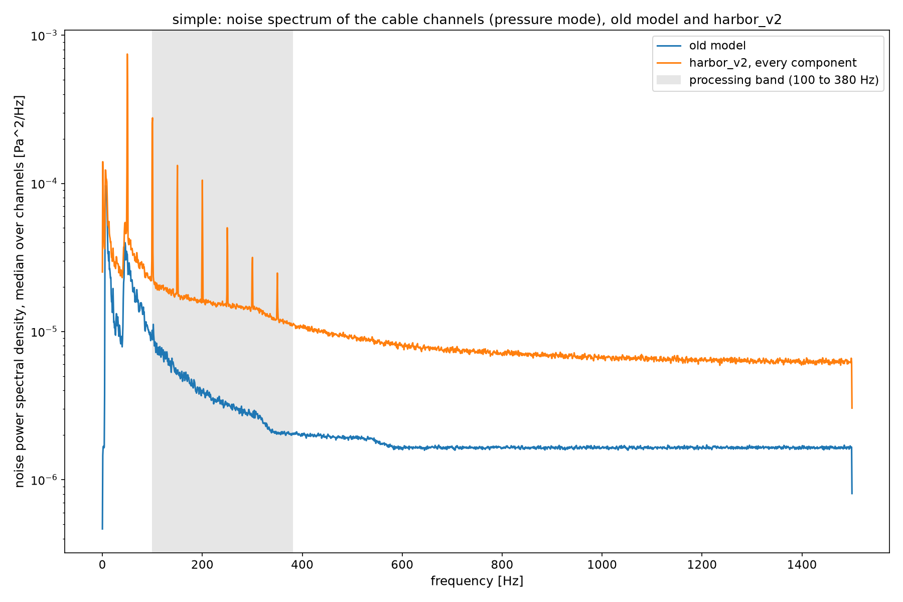
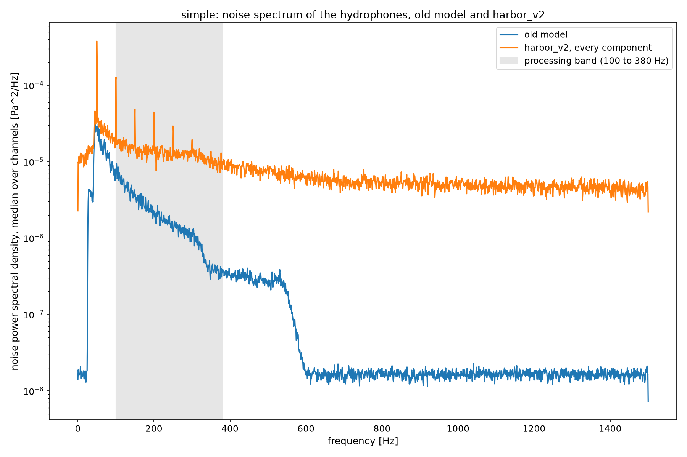
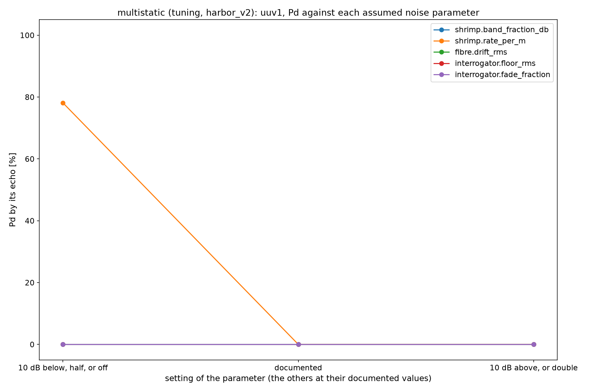
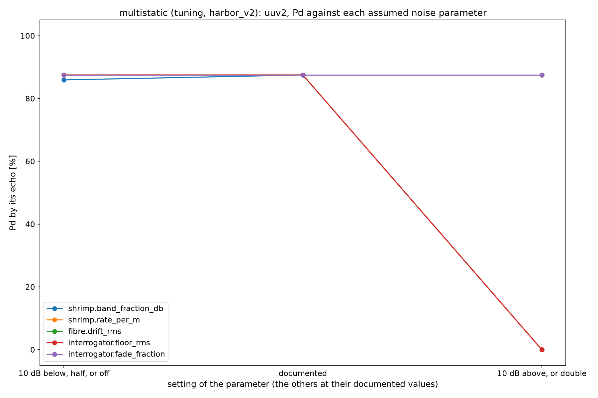
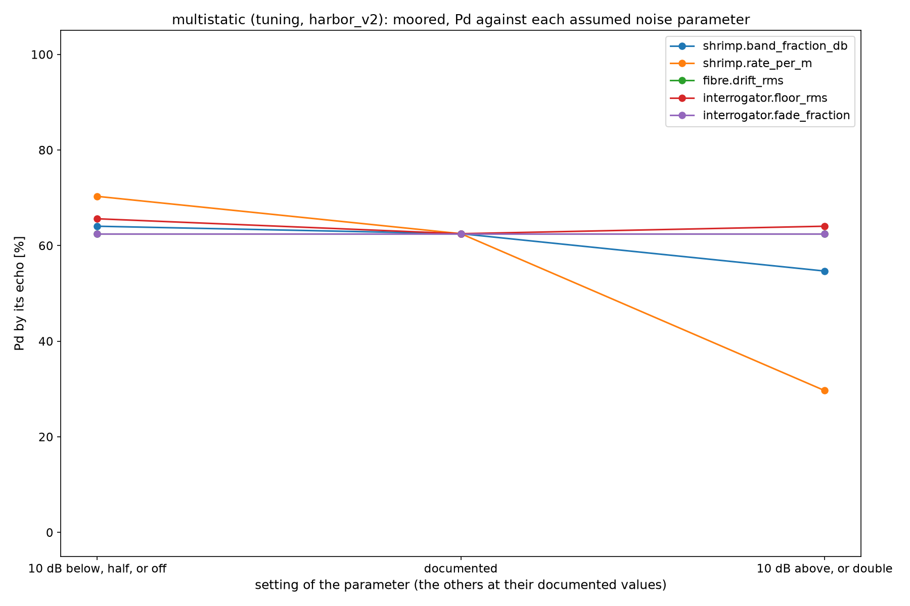
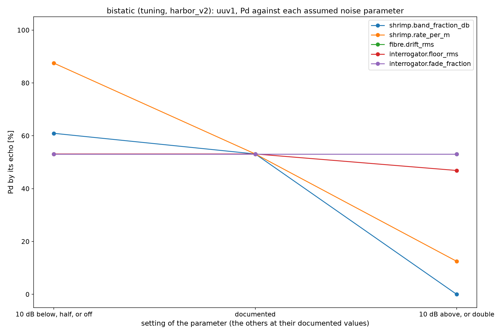
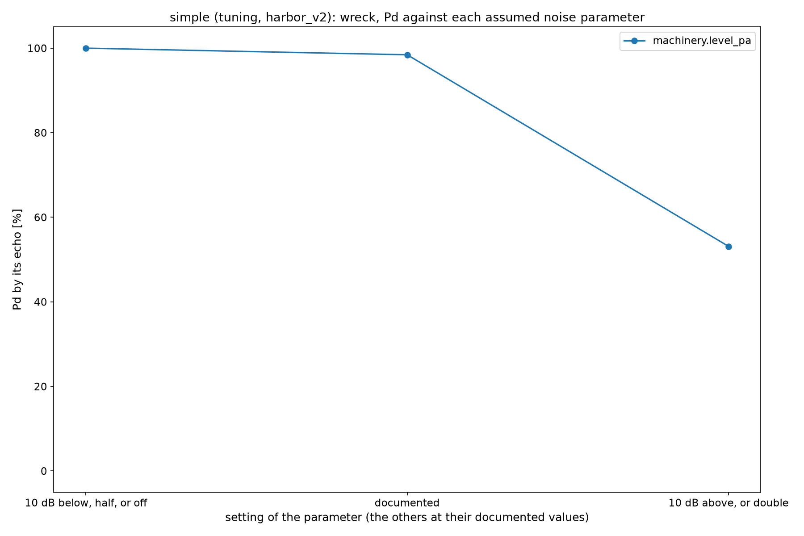
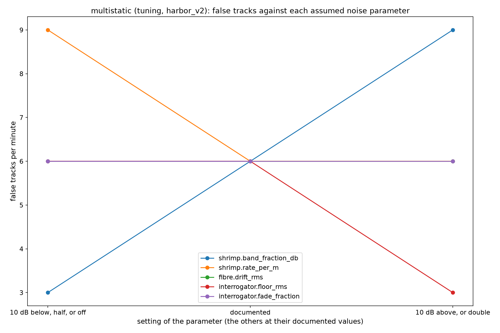

# The noise model

Every Pd and false track number in [Harbor](harbor.md) sits on the noise the recordings were mixed with
(`water/noise.py`). The default model (`noise.model = "default"`, every scenario file) is coloured Gaussian ambient noise,
three plane waves of distant shipping, flat DAS channel noise, common mode noise, gain scatter and dead channels. The
model `"harbor_v2"` keeps all of that and adds five components with sources behind them, each switched on its own
(`noise.harbor_v2.<component>.enabled`, `water.noise.HarborV2Config`). Every number of a component is marked:

* **measured**: taken from a measurement, with the reference;
* **derived**: from a stated physical argument or from a measured number by a stated conversion;
* **assumed**: chosen with no source. No assumed number is presented as measured, and where no measured spectrum was
  found this page says so.

The references were read on the source page unless marked "quoted" (seen only in another document).

## The components

| Component | Shape | Level and parameters | Status |
|---|---|---|---|
| Snapping shrimp | Impulsive clicks, one sample long at these sample rates (a click lasts well under a sample); a Poisson process per metre of land edge; from points along every land edge (water cells next to land, 5 m apart); propagated by the free field sum: delayed by range over the sound speed, spherical spreading to 5 m and cylindrical beyond (a statement of the 2D model, not a measured propagation law) | Peak to peak source level 186 dB re 1 uPa at 1 m, standard deviation 1.5 dB | **measured**: 183 to 189 dB re 1 uPa peak to peak at 1 m, 40 *Synalpheus paraneomeris*, 10 clicks each (Au and Banks, ASA 131st meeting abstract 4aAB8, 1996, https://www.auditory.org/asamtgs/asa96ind/4aAB/4aAB8.html; the paper: Au and Banks 1998, J. Acoust. Soc. Am. 103(1):41 to 47, not read); the normal distribution and its spread from that range are **assumed** |
| | | Energy of a click in the simulated band (below the grid's top frequency, about 1.5 kHz on the simple harbor) 40 dB below its whole band | **assumed**. Measured: the click's spectrum peaks between 2 and 5 kHz and extends to 200 kHz (Au and Banks 1996, above); snap energy extends "from a few hundred hertz" (Bohnenstiehl, Lillis and Eggleston 2016, PLoS ONE 11(1): e0143691, doi:10.1371/journal.pone.0143691, citing others; their own band is 1.5 to 20 kHz). No measurement of the energy below 1 to 2 kHz relative to the peak was found. A first run at 20 dB below put the shrimp 15 to 30 dB above the old model's ambient across the band on the simple harbor's hydrophones and lost both silent bodies (below) |
| | | 0.3 clicks per second per metre of land edge | **assumed**. Measured: 1500 to 2000 snaps per minute in summer and under 100 in winter at one hydrophone on an oyster reef (Bohnenstiehl et al. 2016, above), about 25 to 33 per second; no rate per metre of quay or per unit area was found |
| | | Off unless the scenario gives a latitude within 40 degrees of the equator (`latitude_deg`; no scenario file gives one, so the component is off for every recording unless set) | **measured, quoted**: "an approximate geographic range of plus or minus 40 degrees latitude" (Bohnenstiehl et al. 2016, introduction, citing earlier work; the original was not read). Snap rate follows water temperature (correlation 0.81 over a year, Bohnenstiehl et al. 2016), but no threshold temperature was found, so the component is switched by latitude, not temperature |
| Surface agitation (wind) | Spatially incoherent noise at every sample point, power spectral density falling as frequency to the power -1.7 (-17 log f, about -5 dB per octave) above a knee at 300 Hz and flat below it; its level wanders over minutes (a random walk in dB, 2 dB standard deviation, 120 s correlation time) | At 1 kHz, 44.5 + 30 log10(n + 1) dB re 1 uPa^2/Hz for sea state n (44.5, 53.5, 58.8, 62.6, 65.5, 67.9, 69.9 for 0 to 6); sea state 2 in the study | The slope: **measured, quoted** ("-5 to -6 dB per octave", Knudsen, Alford and Emling 1948, Underwater ambient noise, J. Marine Research 7(3):410 to 429, not read; the model NL(1 kHz) - 17 log(f / 1 kHz) from a course handout, quoted). The levels: **quoted, not verified**: the sea state 0 fit 94.5 + 10 log10(f^(-5/3)) dB re uPa^2/Hz with 30 log(n + 1) added for sea state n, after Urick (arXiv:0712.1833, quoted, not read). The Knudsen table itself was not found. The knee and the slow variation: **assumed** (no measurement of how wind noise varies over minutes was found) |
| Quay machinery | Stationary sources on the quay edge, each lines at 50 Hz and its harmonics (falling 3 dB per harmonic) plus broadband noise 10 dB below the lines, propagated through the forward model (one FDTD run, cached, `dataset.machinery_gather`) | 0.1 Pa rms at 100 m (as the vessels are given); one pump 5 m off the simple harbor's quay at (250, 375) m | The 50 Hz series: **derived** (mains frequency of the machine's supply; 60 Hz elsewhere). Everything else **assumed**: no measured spectrum of quay machinery radiated into harbor water was found |
| Fibre strain noise: drift | Power rising as frequency to the power -2 below 0.1 Hz, independent per channel | 0.02 rms (trace units) | **assumed**. Quoted: drifts of the laser frequency cause low frequency noise that can be mistaken for sub hertz vibration (a BAM paper on phase OTDR, quoted), and reference updates add a 1/f component in the millihertz range (Optics Letters 2022 on chirped pulse DAS, quoted). No spectrum or level was found. Below the processing bands |
| Fibre strain noise: quay traffic | Vehicles pass along each cable; each one's ground motion (3 to 30 Hz) travels along the cable at a ground wave speed and is felt within a correlation length of the vehicle, the envelope moving at the vehicle's speed; so neighbouring channels see it with a delay of their distance over that speed | Band 3 to 30 Hz; vehicles at 15 m/s; felt over 150 m; ground wave speed 300 m/s; 2 vehicles per minute; 0.02 rms while one passes | Band, speed and distance **measured**: vehicles make "high frequency (3 to 30 Hz) anthropogenic surface waves", seen driving at about 15 m/s, and "ground motion could be tracked coherently 100 to 200 m away from the vehicle" (Lindsey et al. 2020, City-scale dark fiber DAS measurements of infrastructure use during the COVID-19 pandemic, GRL 47, e2020GL089931; read in the preprint arXiv:2005.04861). Ground wave speed, rate and level **assumed**. Below the processing bands |
| Interrogator noise | Per channel, a floor whose power rises as (50 Hz / f) below 50 Hz (the laser's phase noise), replacing the flat DAS noise | Floor 0.05 rms (trace units, the old model's flat DAS noise) | The floor: **assumed** (the old model's value). Measured: 3 pe/sqrt(Hz) at 10 Hz on a 10 km fibre with a 10 m gauge (OptoDAS C01-S data sheet, Rev. 04.09.2023, SEAFOM MSP-02, read); the model has no coupling from pressure to fibre strain, so that number cannot be put in its units. The shape: **assumed**: no manufacturer's noise spectrum was found (OptoDAS publishes one frequency; Silixa, OptaSense, Febus, AP Sensing and Sintela publish no value that was found), so the rise toward low frequency is the qualitative statement about laser frequency drift above, not a measured curve |
| Interrogator noise: fading | At any time a fraction of the channels has a floor 10 dB higher, for a while | 10 % of the channels; 3.16 times the floor (10 dB); 2 s mean duration | Fraction **measured**: 9.7 to 11.7 % of points along the fibre below a normalised intensity of 0.1 (-10 dB) with single mode probes, and 8.2 to 10 % of the time at one location (Zhao et al., Interference fading suppression in phi-OTDR using space-division multiplexed probes, arXiv:2103.12394, read). The factor: **derived** from that -10 dB threshold. The duration: **assumed** (not found) |

Not modelled: the shrimp's dependence on time of day and season, the directionality of wind noise, any coupling of the
traffic into the water.

Look at how far the harbor_v2 curve lies above the old one inside the processing band, and which part of the band it
fills.

Look at the same for the hydrophones, which the shrimp clicks and the surface noise reach without the cable's
averaging.

## What the numbers depend on

`examples/harbor/05_detection/harbor_noise_model.py` mixes `simple`, `bistatic`, `multistatic` and `multistatic_b`
again from their cached gathers (seeds 0 to 2) with the old model and with harbor_v2 (every component on; the shrimp at
an assumed latitude of 30 degrees; the machinery on the simple harbor only, the one recording whose machinery was run
through the forward model), and runs the system with the processing configs exactly as on `main`
(`output/studies/noise_model/`; each run's summary is committed there, its `picture.jsonl` and `tracks.csv` are
written again by the script and are in git history at commit `1164bb4`). No pass or fail criterion: the finding is how far
the numbers move.

Old model beside harbor_v2, every recording and seed (`output/studies/noise_model/table.md`):

| Recording | Seed | Noise | Pd per object | Median error [m] per object | False tracks per minute | Compute per s of data |
|---|---|---|---|---|---|---|
| simple | 0 | default | ferry 100 %; boat 100 %; uuv1 30 %; wreck 100 % | ferry 0.5; boat 0.3; uuv1 3.0; wreck 1.2 | 0.0 | 1.09 |
| simple | 0 | harbor_v2 | ferry 100 %; boat 100 %; wreck 98 % | ferry 0.5; boat 0.3; wreck 1.3 | 3.0 | 1.10 |
| simple | 1 | default | ferry 100 %; boat 100 %; uuv1 66 %; wreck 100 % | ferry 0.5; boat 0.2; uuv1 3.0; wreck 1.3 | 0.0 | 1.09 |
| simple | 1 | harbor_v2 | ferry 100 %; boat 100 %; wreck 97 % | ferry 0.5; boat 0.3; wreck 1.3 | 3.0 | 1.09 |
| simple | 2 | default | ferry 100 %; boat 100 %; uuv1 31 %; wreck 100 % | ferry 0.5; boat 0.3; uuv1 2.8; wreck 1.2 | 0.0 | 1.09 |
| simple | 2 | harbor_v2 | ferry 100 %; boat 100 %; uuv1 20 %; wreck 98 % | ferry 0.5; boat 0.3; uuv1 3.1; wreck 1.3 | 6.0 | 1.11 |
| bistatic | 0 | default | ferry 100 %; uuv1 70 % | ferry 0.5; uuv1 1.6 | 9.0 | 1.44 |
| bistatic | 0 | harbor_v2 | ferry 100 %; uuv1 53 % | ferry 0.6; uuv1 1.9 | 0.0 | 1.24 |
| bistatic | 1 | default | ferry 100 %; uuv1 70 % | ferry 0.5; uuv1 1.6 | 3.0 | 1.39 |
| bistatic | 1 | harbor_v2 | ferry 100 %; uuv1 78 % | ferry 0.6; uuv1 1.5 | 0.0 | 1.40 |
| bistatic | 2 | default | ferry 100 %; uuv1 59 % | ferry 0.5; uuv1 2.0 | 6.0 | 1.41 |
| bistatic | 2 | harbor_v2 | ferry 100 %; uuv1 80 % | ferry 0.6; uuv1 1.9 | 0.0 | 1.25 |
| multistatic | 0 | default | ferry 100 %; tug 100 %; boat 100 %; uuv1 83 %; uuv2 97 %; moored 83 % | ferry 0.6; tug 0.8; boat 1.3; uuv1 1.9; uuv2 1.0; moored 0.3 | 6.0 | 2.27 |
| multistatic | 0 | harbor_v2 | ferry 100 %; tug 100 %; boat 100 %; uuv2 88 %; moored 34 % | ferry 0.6; tug 0.5; boat 1.2; uuv2 1.1; moored 2.7 | 6.0 | 1.94 |
| multistatic | 1 | default | ferry 100 %; tug 100 %; boat 100 %; uuv1 66 %; uuv2 95 %; moored 81 % | ferry 0.6; tug 0.8; boat 1.4; uuv1 1.7; uuv2 1.1; moored 0.3 | 6.0 | 2.16 |
| multistatic | 1 | harbor_v2 | ferry 100 %; tug 100 %; boat 100 %; uuv1 6 %; uuv2 88 %; moored 58 % | ferry 0.6; tug 0.7; boat 1.5; uuv1 1.9; uuv2 0.7; moored 0.2 | 3.0 | 2.16 |
| multistatic | 2 | default | ferry 100 %; tug 100 %; boat 100 %; uuv1 62 %; uuv2 94 %; moored 80 % | ferry 0.6; tug 0.7; boat 1.3; uuv1 1.7; uuv2 0.6; moored 0.8 | 6.0 | 2.17 |
| multistatic | 2 | harbor_v2 | ferry 100 %; tug 100 %; boat 100 %; uuv2 91 %; moored 72 % | ferry 0.6; tug 0.6; boat 1.4; uuv2 1.1; moored 1.4 | 3.0 | 2.02 |
| multistatic_b | 0 | default | ferry 99 %; tug 100 %; boat 70 %; uuv1 60 %; uuv2 88 % | ferry 0.3; tug 0.5; boat 0.2; uuv1 1.6; uuv2 1.0 | 7.0 | 2.28 |
| multistatic_b | 0 | harbor_v2 | ferry 99 %; tug 100 %; boat 56 %; uuv1 31 %; uuv2 81 % | ferry 0.4; tug 0.5; boat 0.3; uuv1 1.3; uuv2 1.3 | 4.0 | 2.09 |
| multistatic_b | 1 | default | ferry 99 %; tug 100 %; boat 69 %; uuv1 62 %; uuv2 96 % | ferry 0.3; tug 0.4; boat 0.2; uuv1 1.6; uuv2 1.3 | 6.0 | 2.28 |
| multistatic_b | 1 | harbor_v2 | ferry 99 %; tug 100 %; boat 57 %; uuv1 49 %; uuv2 82 % | ferry 0.3; tug 0.5; boat 0.3; uuv1 1.8; uuv2 1.1 | 4.0 | 2.09 |
| multistatic_b | 2 | default | ferry 99 %; tug 100 %; boat 69 %; uuv1 53 %; uuv2 97 % | ferry 0.3; tug 0.5; boat 0.2; uuv1 1.5; uuv2 1.2 | 7.0 | 2.26 |
| multistatic_b | 2 | harbor_v2 | ferry 99 %; tug 100 %; boat 57 %; uuv1 45 %; uuv2 85 % | ferry 0.3; tug 0.5; boat 0.3; uuv1 1.3; uuv2 1.3 | 6.0 | 2.11 |

What moved:

* **The ships do not move**: the ferry, the tug and the multistatic boat keep their Pd on every recording; only the
  `multistatic_b` boat falls (70 to 57 % on every seed).
* **The silent bodies move most**, both ways. The multistatic first UUV is lost (83, 66, 62 % to 0, 6, 0 %) and the
  moored hull falls (83, 81, 80 % to 34, 58, 72 %); the simple harbor's UUV is lost on two of three seeds; on
  `multistatic_b` the first UUV falls from 53 to 62 % to 31 to 49 %. The bistatic UUV goes the other way on seeds 1 and
  2 (70 and 59 % to 78 and 80 %) and down on seed 0 (70 to 53 %).
* **False tracks** move both ways: up on the simple harbor (0 to 3 to 6 per minute), down on the bistatic recording
  (3 to 9 to 0 per minute) and on `multistatic_b` (6 to 7 to 4 to 6).
* **Compute** moves by up to 0.3 s per second of data, mostly down (fewer echo tracks to measure).

One component at a time on the simple harbor's seed 0 (`components.md`):

| Components on | Pd per object | False tracks per minute | Compute per s of data |
|---|---|---|---|
| none (the old model) | ferry 100 %; boat 100 %; uuv1 30 %; wreck 100 % | 0.0 | 1.09 |
| shrimp | ferry 100 %; boat 100 %; uuv1 30 %; wreck 100 % | 0.0 | 1.09 |
| surface | ferry 100 %; boat 100 %; uuv1 30 %; wreck 100 % | 0.0 | 1.30 |
| machinery | ferry 100 %; boat 100 %; wreck 98 % | 6.0 | 1.11 |
| fibre | ferry 100 %; boat 100 %; uuv1 30 %; wreck 100 % | 0.0 | 1.09 |
| interrogator | ferry 100 %; boat 100 %; uuv1 30 %; wreck 100 % | 0.0 | 1.09 |
| all | ferry 100 %; boat 100 %; wreck 98 % | 3.0 | 1.10 |

The quay machinery alone accounts for the simple harbor's change: it is the only component that loses the UUV and adds
false tracks (6 per minute: tracks on the pump, which radiates and is not in the truth, so every track of it is
counted false). The shrimp at 40 dB below their whole band, the wind at sea state 2, the fibre's own strain noise
(below the processing band) and the interrogator noise with fading (on a pressure cable whose 299 channels average it)
change nothing on that recording; on the strain cable recordings, where the components come together, the silent
bodies move as above, and which component moves them there was not measured one at a time. With the shrimp at 20 dB
below their whole band instead (an earlier run, `scratch` only), they lay 15 to 30 dB above the old model's ambient on
the simple harbor's hydrophones and both silent bodies were lost: the result rests on that assumed number.

The finding: the radiating ships' numbers hardly depend on the noise model; the silent bodies' and the false tracks'
do, by tens of percentage points and several tracks per minute, and most of all on components whose levels are
assumed (a radiating machine on the quay, the shrimp's energy in the band).

## Both models in the numbers

`scripts/reproduce.py` runs every recording twice: as built, with the old model, and mixed again from the same FDTD
gathers and the same noise seeds with `harbor_v2` at its documented levels (every component on, the shrimp at the
assumed latitude of 30 degrees, the quay machinery on the simple harbor only, the one recording with a machinery gather;
`output/recordings/<recording>/noise2/`, the runs in `output/reproduce/runs/<recording>_noise2/`). `summary.json` carries
both (`recordings`, `recordings_noise2`) and `--check` compares both. The criteria of [Harbor](harbor.md#criteria) are
evaluated on the old model as they were fixed, and reported on harbor_v2 beside it: there
<!-- reproduce:ntrue:criteria_noise2[*]/passed -->1<!-- /reproduce --> of
<!-- reproduce:count:criteria_noise2[*]/passed -->4<!-- /reproduce --> are met. The silent bodies, by their echo:

<!-- reproduce-table:silent_noise -->
| Recording | Silent body | Pd, old noise model | Pd, harbor_v2 |
|---|---|---|---|
| simple | uuv1 | 58 % | 20 % |
| simple | wreck | 100 % | 98 % |
| bistatic | uuv1 | 89 % | 53 % |
| multistatic | uuv1 | 84 % | 0 % |
| multistatic | uuv2 | 95 % | 88 % |
| multistatic | moored | 83 % | 62 % |
| simple_seed1 | uuv1 | 66 % | 0 % |
| simple_seed1 | wreck | 100 % | 97 % |
| simple_seed2 | uuv1 | 64 % | 0 % |
| simple_seed2 | wreck | 100 % | 98 % |
| simple_seed3 | uuv1 | 58 % | 25 % |
| simple_seed3 | wreck | 100 % | 98 % |
| bistatic_seed1 | uuv1 | 55 % | 78 % |
| bistatic_seed2 | uuv1 | 6 % | 80 % |
| bistatic_seed3 | uuv1 | 53 % | 80 % |
| multistatic_seed1 | uuv1 | 89 % | 0 % |
| multistatic_seed1 | uuv2 | 94 % | 91 % |
| multistatic_seed1 | moored | 91 % | 62 % |
| multistatic_seed2 | uuv1 | 80 % | 14 % |
| multistatic_seed2 | uuv2 | 94 % | 92 % |
| multistatic_seed2 | moored | 83 % | 72 % |
| multistatic_seed3 | uuv1 | 80 % | 0 % |
| multistatic_seed3 | uuv2 | 91 % | 83 % |
| multistatic_seed3 | moored | 86 % | 62 % |
| multistatic_b | uuv1 | 59 % | 46 % |
| multistatic_b | uuv2 | 96 % | 84 % |
| multistatic_b | diver | 81 % | 0 % |
<!-- /reproduce-table -->

What the table says: the simple harbor's wreck and the second UUV of the multi ship scene hardly move; the moored hull
loses tens of points; the simple harbor's UUV, the first UUV of the multi ship scene and the diver of `multistatic_b`,
tracked under the old model, are lost or nearly lost under harbor_v2; the bistatic UUV goes the other way and is tracked
more often under harbor_v2 on its test seeds. The ships do not move ([Harbor](harbor.md#real-time-tuning-recordings-beside-test-recordings)).
So the silent body numbers of [Harbor](harbor.md) are given as their range over the two models.

## Which assumed number matters

`examples/harbor/05_detection/harbor_noise_sweep.py` (output in `output/studies/noise_model/sweep/`, `results.json`
with every value used and no criterion): on the multistatic and the bistatic tuning recordings (noise seed 0, mixed
from the cached gathers), one assumed parameter of harbor_v2 at a time at three settings, everything else at its
documented value and the chain unchanged: the shrimp's band energy and rate 10 dB below and above, the fibre's drift
and the interrogator's floor 10 dB below and above, the fading fraction halved and doubled. The quay machinery (off,
assumed, 10 dB above) needs a machinery gather, which only the simple harbor has, and no FDTD run was allowed, so it
was swept on the simple harbor's tuning recording instead. The span of each silent body's Pd over the three settings:

* **The shrimp** move the most: their band energy moves the multistatic second UUV by
  <!-- reproduce:@studies/noise_model/sweep/results.json:span_of_pd/multistatic/shrimp.band_fraction_db/uuv2|pct -->88 %<!-- /reproduce --> and the bistatic UUV by <!-- reproduce:@studies/noise_model/sweep/results.json:span_of_pd/bistatic/shrimp.band_fraction_db/uuv1|pct -->61 %<!-- /reproduce -->;
  their rate moves the multistatic first UUV by <!-- reproduce:@studies/noise_model/sweep/results.json:span_of_pd/multistatic/shrimp.rate_per_m/uuv1|pct -->78 %<!-- /reproduce -->, its second by
  <!-- reproduce:@studies/noise_model/sweep/results.json:span_of_pd/multistatic/shrimp.rate_per_m/uuv2|pct -->88 %<!-- /reproduce -->, the moored hull by <!-- reproduce:@studies/noise_model/sweep/results.json:span_of_pd/multistatic/shrimp.rate_per_m/moored|pct -->41 %<!-- /reproduce --> and
  the bistatic UUV by <!-- reproduce:@studies/noise_model/sweep/results.json:span_of_pd/bistatic/shrimp.rate_per_m/uuv1|pct -->75 %<!-- /reproduce -->.
* **The interrogator's floor** moves the multistatic second UUV by <!-- reproduce:@studies/noise_model/sweep/results.json:span_of_pd/multistatic/interrogator.floor_rms/uuv2|pct -->88 %<!-- /reproduce -->
  (the bistatic UUV by <!-- reproduce:@studies/noise_model/sweep/results.json:span_of_pd/bistatic/interrogator.floor_rms/uuv1|pct -->6 %<!-- /reproduce -->).
* **The machinery** moves the simple harbor's wreck by <!-- reproduce:@studies/noise_model/sweep/results.json:span_of_pd/simple/machinery.level_pa/wreck|pct -->47 %<!-- /reproduce --> and its UUV by
  <!-- reproduce:@studies/noise_model/sweep/results.json:span_of_pd/simple/machinery.level_pa/uuv1|pct -->34 %<!-- /reproduce -->.
* **The fibre's drift and the fading fraction** move nothing (3 points or less on every silent body): the drift lies
  below the processing band and the fading averages out over the cable's channels.

These are the numbers a field recording has to pin, the shrimp first ([One field recording](field_recording.md)).

Look at the shrimp's rate: the first UUV is tracked only with ten times fewer clicks than assumed.

Look at the three parameters that each take the second UUV from tracked to lost at one end of their range.

Look at the hull's Pd falling as the shrimp's rate rises.

Look at the shrimp's two parameters, and how little the interrogator's floor does on this recording.

Look at the wreck against the machinery's level: down to about half its frames when the pump is 10 dB louder than assumed.

Look at the false tracks of the multistatic recording: each parameter moves them by about one track either way.
